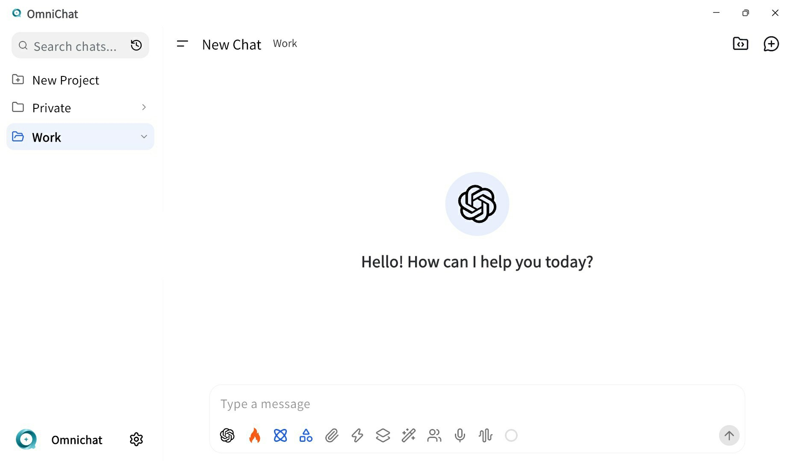
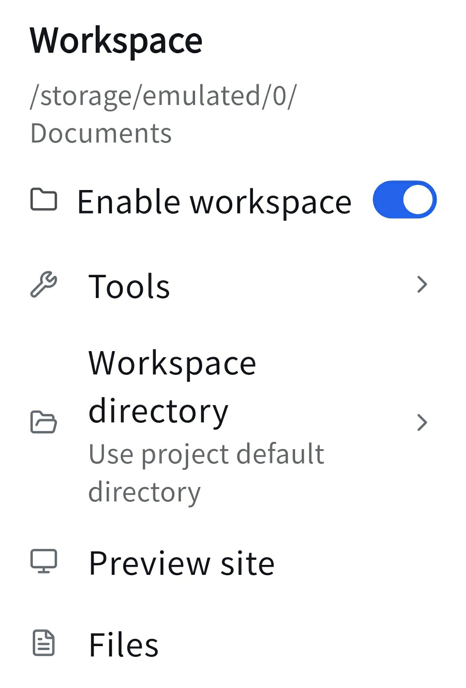
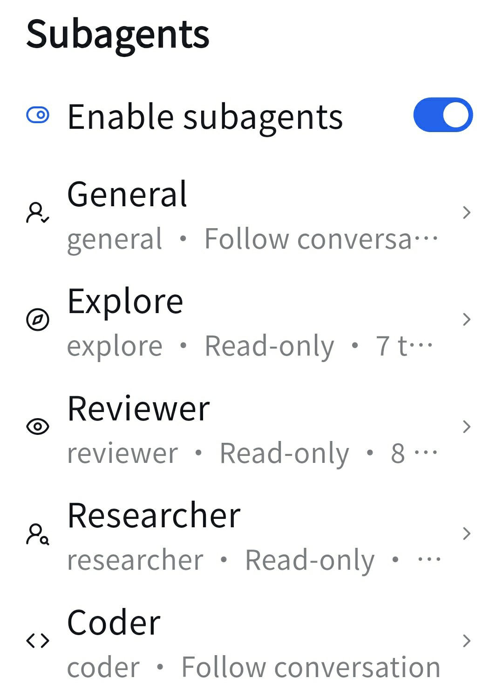
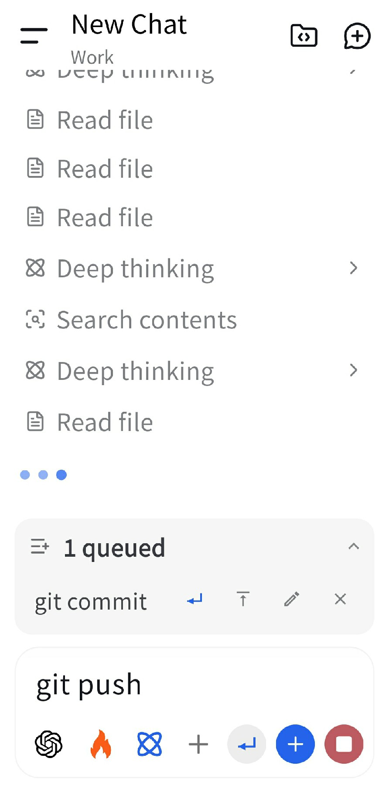
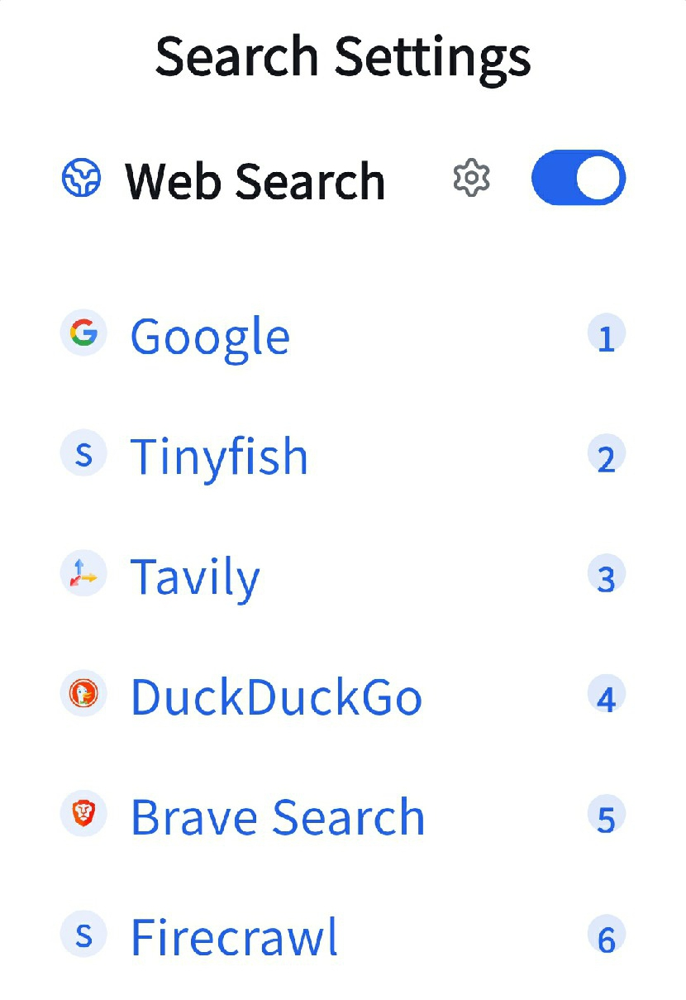
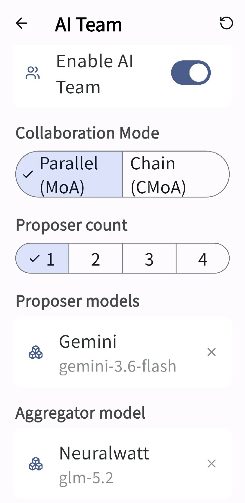
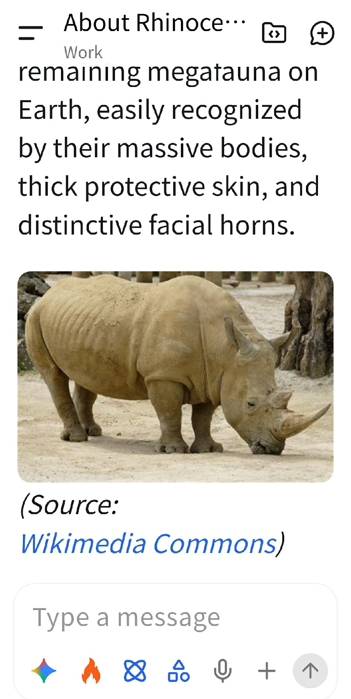
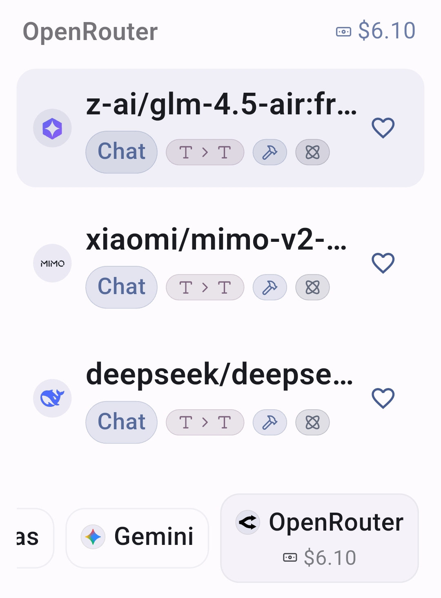

# OmniChat

> An agentic, cross-platform AI client that works with your files, delegates to sub-agents, researches in depth, and talks back — on any LLM provider.

  
  
  = 3.47" />

English | [繁體中文](README_ZH_TW.MD)

---

  

OmniChat is a modern, feature-rich AI chat application built for real work: file editing inside a sandboxed workspace, agentic tool use with sub-agents and skills, deep research, multi-agent collaboration, seamless voice interaction, and a unified cross-platform experience.

## Key Features

### Workspace

Give the AI direct access to your files — everything happens inside a folder you choose, safely sandboxed:

- **Flexible Setup**: Choose a global default folder, set a workspace per project, or override it for a single conversation — or use the app-private directory. One switch turns the workspace (and all of its tools) on or off.
- **File Management**: Ask the AI to read, create, edit, patch, delete, move, copy, search (by name or by content with regex), or unzip files inside your chosen folder.
- **Reads Common File Formats**: TXT, MD, HTML, CSV, SVG, JSON, XML, YAML, DOCX, XLSX, PPTX, and PDF — plus images, which vision models can inspect directly.
- **Create Documents, Slides, Reports, Charts & PDFs**: Supports TXT, MD, HTML, CSV, SVG, PDF, and more (DOCX, XLSX, PPTX not yet supported).
- **Shell Commands**: Run commands inside the workspace on desktop, and through a bundled PRoot Linux shell on Android (arm64-v8a).
- **Permissions You Control**: Access outside the workspace and shell commands each default to *Ask* (one approval card per action) and can be switched to *Allow all*. Individual tools can be disabled on the Tools page.
- **Live Site Preview**: Preview HTML pages generated in the workspace with auto-reload, desktop/tablet/phone viewports, and a console the AI can read to fix its own errors.

  

---

### Sub-agents

Delegate self-contained subtasks to an isolated helper — only the final result comes back, keeping the main conversation lean:

- **Isolated Context**: A helper starts fresh with just its task; its intermediate tool calls never flood the parent conversation.
- **Two Ways to Delegate**: Let the model spawn a helper on its own, or type `@profile your task` (or pick a profile from the Add-ons menu) to delegate directly — bypassing the main model.
- **Profiles**: Five built-in profiles (General, Explore, Reviewer, Researcher, Coder) plus up to 20 custom ones. Each profile defines its instructions, allowed tools, read-only mode, provider & model, max steps (1–40), and token budget.
- **Read-Only Guarantee**: Read-only profiles always block write, shell, and memory-write tools.
- **Follow-Up Sessions**: Tap **Continue** on a delegated result to ask the same helper a follow-up within its session.
- **Live Tool Cards**: Watch each helper tool call as it runs, with timing, result size, step count, and token usage.

  

---

### Skills

Teach the AI reusable workflows with `SKILL.md` skill packs — compatible with the Claude Code / Agent Skills format:

- **One Folder = One Skill**: A `SKILL.md` (YAML frontmatter + Markdown instructions) plus any supporting files (scripts, references, assets).
- **Global & Project Scopes**: Global skills live in `~/.agents/skills/` on desktop (shared with other agent tools); project skills are auto-discovered from `.agents/skills/` in the conversation workspace and override same-named global skills.
- **Two Ways to Invoke**: Use the `/skill <name>` command or the Skills button in the input bar — or enable **Preload skills** so the model can load the right skill on its own.
- **Easy Installation**: Create a skill in the app, import a `SKILL.md` together with its folder, or download one straight from a GitHub repository.
- **Always Fresh**: Skills are read from disk on every use — edits take effect immediately, no restart needed.

---

### Send Now & Queue

Keep typing while the AI is still working — no more waiting for a turn to finish:

- **Queue (Enter)**: Messages (including attachments) are queued and sent automatically, in order, as soon as the current turn ends.
- **Send Now (Ctrl/Cmd+Enter)**: Inject a text message into the running turn to steer the AI mid-task; it takes effect before the next step.
- **Queue Dock**: Review queued messages above the input bar — edit inline, move to front, send now, or remove.
- **Safe by Design**: Pressing Stop pauses the queue (resume with one tap), and a message that fails to send twice in a row pauses the queue instead of retrying forever.

  

---

### Auto-Detected Model Settings

Add a model and start chatting — OmniChat works out the details for you:

- **Built-in Model Catalog**: Powered by [models.dev](https://models.dev), OmniChat automatically fills in each model's context window, max output, input/output modalities, and capabilities (vision, tool calling, reasoning, sampling support). The catalog ships offline and refreshes in the background when you add providers or models.
- **Editable with Clear Markers**: Every auto-detected value can be overridden; sections show a **Default / Custom** badge and a one-tap reset.
- **Reasoning Effort Probe**: For brand-new models, probe which reasoning levels (none → max) the API actually accepts and apply the result after confirmation — no app update needed.
- **Reasoning Parameter Format**: Pick the reasoning wire format per model when a provider uses a non-standard dialect.
- **Learned Limits**: Output and context limits announced by the server are learned and remembered automatically, so replies are never cut off by outdated defaults.

---

### Context Management

Stay on top of long conversations:

- **Context Usage Display**: A usage ring in the input bar shows how much of the model's context window the conversation consumes.
- **Automatic Mechanical Compression**: As the context fills up, OmniChat trims oversized tool results and condenses older history into a deterministic summary — in memory only, with your saved chat history never touched. Tool calls are always kept paired with their results, and long agent runs are re-evaluated between steps.
- **Manual LLM Compression**: Use **Compress Context** to have a dedicated compression model (fast models recommended, custom prompt template supported) summarize the chat and continue in a new conversation. Choose whether to send the start or the most recent part, and how many characters.

---

### Multi-Provider Search Dispatch (Fallback + Round-Robin)

Integrated with a wide range of search providers — Google, Tinyfish, Tavily, Exa (incl. Exa MCP), Brave, Serper, SearXNG, Bing, You.com, Parallel, and more, as well as provider-native search (OpenRouter, Claude, Gemini, Grok) — and dispatches every search smartly:

- **Multi-Select with Priority**: The list order defines the failover priority — drag & drop to rearrange it.
- **Two Dispatch Modes**: `Fallback` (sequential failover in priority order) or `Round-Robin` (a rotating cursor spreads load across providers).
- **Smart Failover**: On rate limits (429), timeouts, or errors, the engine automatically switches to the next provider — with a 60-second cooldown for rate-limited ones; empty results are treated as valid answers and never trigger failover.
- **Transparent UI**: Search tool cards show the responding provider's badge and a "switched from X to Y" notice whenever failover happens.

  

---

### Self-Review

Let the model check its own work before you see it:

- **Review, Then Revise**: Before the final answer is sent, the same model reviews its draft and either passes it or revises it once — with full tool access, so it can actually fix what it found.
- **Three Modes**: `Off`, `Smart` (only when tool results, long answers, code, numbers, or URLs are present), or `Always`.
- **Transparent Results**: A collapsible Self-Review card lists findings by severity (blocker / major / minor), the revision diff, time, and token usage.
- **Fail-Open**: If the review times out or fails, the original answer is kept — you never lose a response.

---

### Deep Research

Preset agent protocol designed for complex scientific, technical, and investigative research:

- **Dual Think & Search Engine**: Combines multi-round deep reasoning with real-time web search. Uses targeted search queries to resolve uncertainties and fuels subsequent reasoning loops.
- **Epistemic Discipline**: Enforces a strict distinction between *Evidence* (empirical facts), *Inference* (logical deductions), and *Judgment* (value choices).
- **Rigorous Synthesis**: Dynamic stopping criteria based on information saturation, producing decision-useful research reports backed by verifiable citations and epistemic calibration.

---

### AI Team (Mixture of Agents)

Supports two advanced multi-agent collaboration pipelines for complex problem solving:

- **Parallel (MoA)**: Orchestrate 1–4 "proposer" models to explore a question independently, then let an "aggregator" model synthesize their perspectives into a single, comprehensive response.
- **Chain (CMoA)**: Sequential reasoning chain (Proposer → Self-Audit Critics 0~3 → Aggregator). Critics apply 7 Analytical Lenses (Adversarial, Causal/Structural, Comparative, Temporal, etc.) to stress-test and audit preceding outputs.
- **Real-Time Streaming**: Proposals and audit logs stream live as each model completes, rendered in clean, layered collapsible sections — including each model's thinking and tool calls.

  

---

### Academic Search

Built-in free academic search providers for scholarly literature, fully integrated into the search service:

- **arXiv**: Search preprints through the official arXiv API — no API key or registration required, with automatic rate-limit throttling (one request every 3 seconds).
- **PubMed (E-utilities)**: Two-step esearch → efetch flow returns paper titles and abstracts from NCBI.
- **Semantic Scholar**: Paper search via the Academic Graph API with graceful rate-limit messaging.

All three providers work out of the box; PubMed and Semantic Scholar accept an optional API key to raise their rate limits. Official brand icons are displayed across all UI surfaces (mobile & desktop).

---

### Illustrate (Built-in Image Search MCP Server)

Zero-config, key-free image retrieval — the AI embeds images of people, products, landmarks, and animals directly into its replies:

- **Built-In & Ready**: An in-memory MCP server (`Illustrate`) ships with OmniChat and exposes a single `illustrate(query, max_results)` tool (1–15 results).
- **Inline Markdown Images**: Results are inserted straight into the reply as `` — no files ever touch your disk.
- **Dual Backends**: DuckDuckGo's image index is queried first; Wikimedia Commons (including author and license info) automatically takes over when results are empty or unusable.
- **Dead-Link Filtering**: Top candidate thumbnails are HEAD-verified (HTTP 200 + image content type) before the model ever sees them.

  

---

### Local JavaScript MCP

A secure, sandboxed JavaScript runtime (QuickJS / JavaScriptCore) that lets the AI execute code locally for precise calculations and data processing — no server, no network round-trip.

---

### Inline Voice Dictation

Dictate text directly into the chat input bar:

- **System Speech Recognition**: Low-latency native STT with append mode and a silence watchdog; localized for English and Chinese.
- **Cloud Transcription (Optional)**: Choose OpenAI Whisper, Groq, Mistral Voxtral, ElevenLabs Scribe, or Qwen Audio for higher-accuracy batch transcription; without a selected service, dictation falls back to system STT.

---

### Real-Time Voice Chat

Experience AI interaction as natural as a phone call:

- **Universal Model Support**: Connect with your preferred LLM backends.
- **Gemini Live API**: Full-duplex, low-latency voice conversation with real-time two-way captions; the AI can search the web mid-call and speak the results.
- **Rich TTS Options**: Qwen, Groq, xAI, MiMo, Edge-TTS, MiniMax, OpenAI, and Azure TTS, with system TTS as a fallback.
- **Bluetooth Optimization**: Enhanced headset detection and audio routing in Call Mode.

---

### Account Balance Monitoring

Keep track of your usage effortlessly. Real-time account balance is displayed directly within the Model Selection menu and Provider Settings (supports OpenAI, Gemini, DeepSeek, OpenRouter, Neuralwatt, and more).

  

---

### Customizable New Chat Empty State & Dynamic AI Greetings

Personalize your empty chat screen with zero-latency greetings and branding:

- **Flexible Logo & Icon Display**: Choose between OmniChat logo, active model icon, custom uploaded image, or hidden logo.
- **Zero-Latency AI Dynamic Greetings**: Pre-caches AI-generated warm greetings in the background upon app start for instant display.
- **Dedicated Greeting Model & Prompts**: Independently select the model for greeting generation, customize prompts, and toggle thinking budget (Enable Thinking).
- **Refined Visual Layout**: Enlarged logo aesthetics (100px) and bold typography for a modern, premium feel.

---

### Customizable Input Bar Buttons

Tailor the chat input bar tools to your workflow — one shared layout for mobile and desktop:

- **Drag to Reorder**: Rearrange input bar buttons (model selector, web search, MCP, skills, quick phrases, dictation, camera/photos, file upload, reasoning, AI Team, instruction injection, voice chat, context management, OCR) in **Settings → Display Settings → Input Bar Buttons**.
- **Show/Hide Toggles**: Hide rarely used buttons entirely; platform-specific buttons (camera/photos on mobile, file upload/OCR on desktop) are only shown where available.
- **One-Tap Reset**: Restore the default order and visibility anytime.

---

### Cross-Platform Support

Enjoy a consistent experience across your devices:

- **Windows**
- **Android**

> [!NOTE]
> The Android PRoot shell (`shell_exec`) is **arm64-v8a only**. On other ABIs (`armeabi-v7a`, `x86_64`), all other app features remain available.

---

## License & Acknowledgements

OmniChat is a fork of [Kelivo](https://github.com/Chevey339/kelivo) — an AGPL-3.0-licensed Flutter LLM chat client by [Chevey339](https://github.com/Chevey339), with UI design inspired by RikkaHub.

The built-in model catalog is derived from [models.dev](https://models.dev) (MIT License).

OmniChat is distributed under the [GNU Affero General Public License v3.0](LICENSE), the same license as its upstream project. In accordance with the AGPL-3.0, the original copyright of the upstream code is retained.
