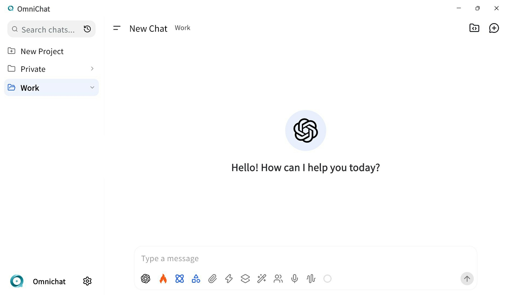
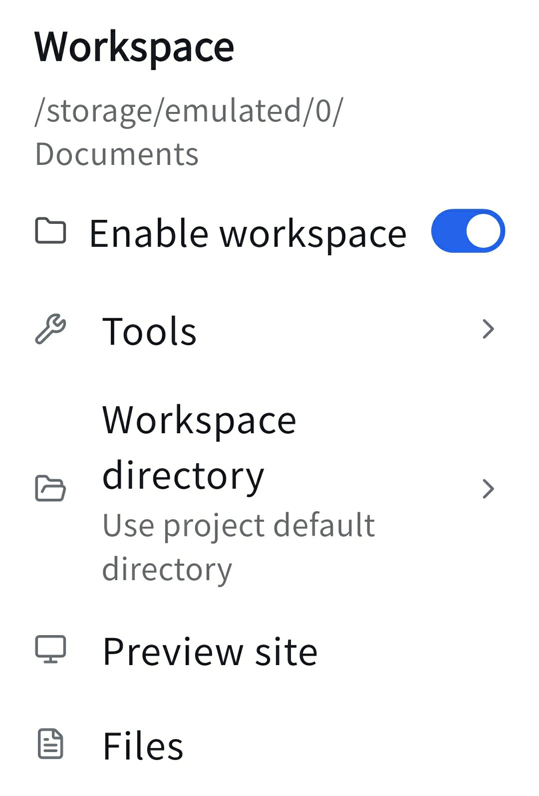
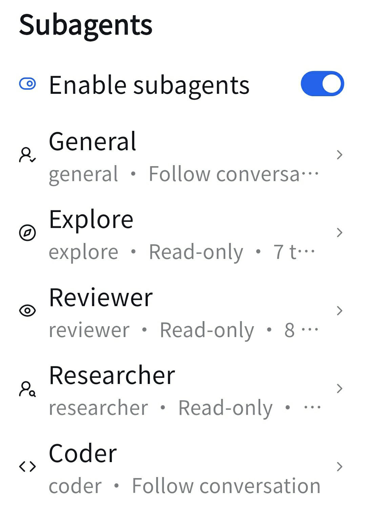
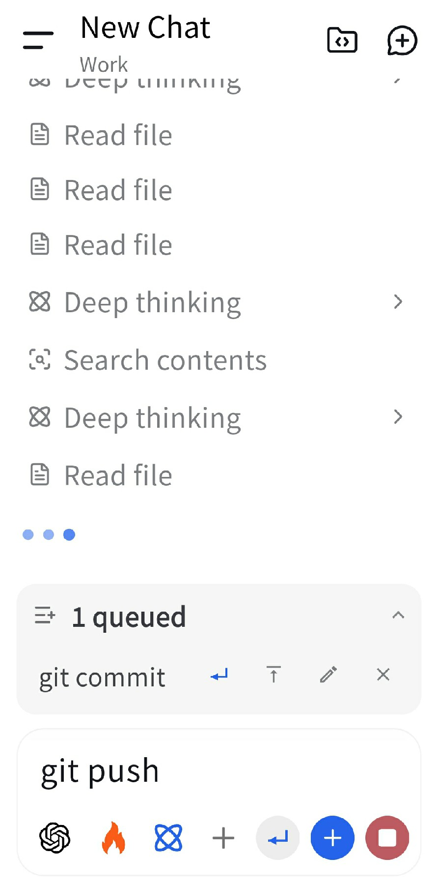
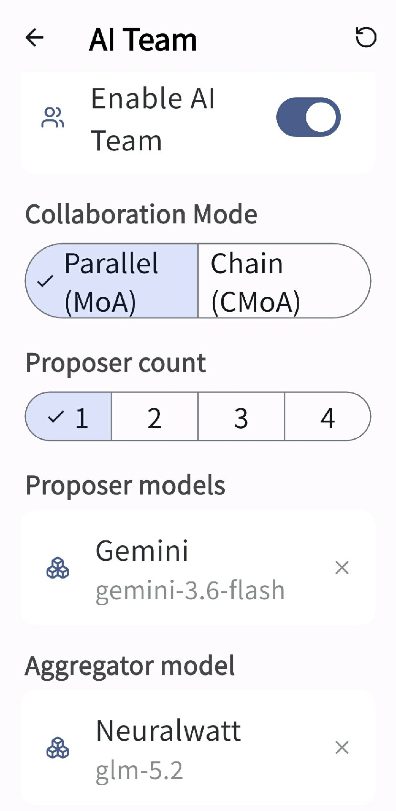
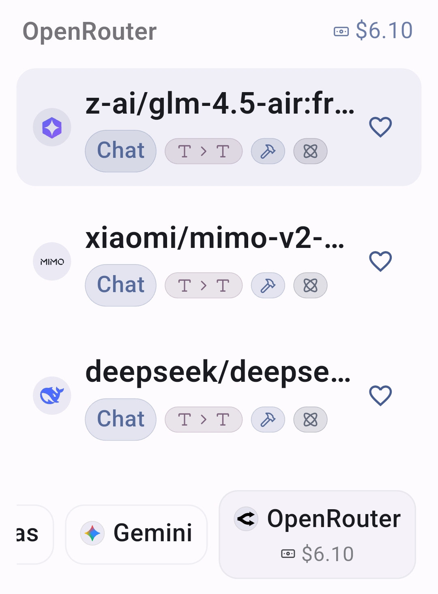

# OmniChat

> 具備代理能力的跨平台 AI 客戶端：能處理您的檔案、把任務交給子代理、進行深度研究，還能與您語音對話——支援任何 LLM 供應商。

  
  
  = 3.47" />

[English](README.md) | 繁體中文

---

  

OmniChat 是一款現代化、功能豐富的 AI 聊天軟體，專為實際工作而生：在沙盒化的工作區內編輯檔案、透過子代理與技能進行代理式工具操作、深度研究、AI 團隊協作、流暢的語音互動，以及一致的跨平台體驗。

## 核心特色

### 工作區

讓 AI 直接存取您的檔案——所有操作都在您指定的資料夾內安全地進行：

- **彈性設定**：可設定全域預設資料夾、為每個專案指定工作區、只針對單一對話調整，或使用 App 私有目錄。一個開關即可啟用或停用工作區（及其所有工具）。
- **檔案管理**：請 AI 讀取、建立、編輯、套用修補、刪除、移動、複製、搜尋（依檔名或以正規表示式搜尋內容）或解壓縮您指定資料夾中的檔案。
- **讀取常用文件格式**：TXT、MD、HTML、CSV、SVG、JSON、XML、YAML、DOCX、XLSX、PPTX、PDF，以及可由視覺模型直接檢視的圖片。
- **建立文件、簡報、報表、圖表與 PDF**：支援 TXT、MD、HTML、CSV、SVG、PDF 等格式（DOCX、XLSX、PPTX 暫不支援）。
- **Shell 命令**：桌面版可在工作區內執行命令；Android 版透過內建的 PRoot Linux Shell 執行（僅限 arm64-v8a）。
- **權限由您掌控**：存取工作區外的檔案與執行 Shell 命令預設皆為「詢問」（每個動作一張審批卡），也可切換為「全部允許」；個別工具可在「工具」頁面停用。
- **即時網站預覽**：預覽工作區中產生的 HTML 頁面，支援自動重新載入、桌面／平板／手機視窗切換，以及 AI 可讀取並自行修正錯誤的主控台。

  

---

### 子代理

把可獨立完成的子任務交給隔離的子代理，只收回最終結果，讓主對話保持精簡：

- **隔離的上下文**：子代理僅帶著任務本身從零開始，其中間的工具呼叫不會灌入主對話。
- **兩種委派方式**：讓模型自行派出子代理，或輸入 `@設定檔 任務內容`（也可從 Add-ons 選單挑選設定檔）直接委派——完全不經過主模型。
- **子代理設定檔**：內建五種設定檔（General、Explore、Reviewer、Researcher、Coder），另可自訂最多 20 個。每個設定檔可定義指示、允許的工具、唯讀模式、供應商與模型、最大步數（1–40）及 Token 預算。
- **唯讀保證**：唯讀設定檔一律封鎖寫入、Shell 與記憶寫入工具。
- **延續對話**：在委派結果上點選「繼續」，即可在同一個工作階段中向同一個子代理追問。
- **即時工具卡片**：即時查看子代理的每一次工具呼叫，包含耗時、結果大小、步數與 Token 用量。

  

---

### 技能

以 `SKILL.md` 技能包教會 AI 可重複使用的工作流程——相容於 Claude Code / Agent Skills 格式：

- **一個資料夾＝一個技能**：包含 `SKILL.md`（YAML frontmatter＋Markdown 指示）及任意附屬檔案（腳本、參考資料、素材）。
- **全域與專案範圍**：桌面版的全域技能存放於 `~/.agents/skills/`（與其他代理工具共用）；專案技能會從對話工作區的 `.agents/skills/` 自動探索，並覆寫同名的全域技能。
- **兩種調用方式**：使用 `/skill <名稱>` 指令或輸入列的「技能」按鈕——或開啟「預載技能」，讓模型自行載入合適的技能。
- **輕鬆安裝**：可在 App 內建立技能、連同資料夾匯入 `SKILL.md`，或直接從 GitHub 儲存庫下載。
- **即改即用**：每次使用都從磁碟讀取技能——修改後立即生效，無需重新啟動。

---

### 立即插入與排入佇列

AI 仍在工作時也能繼續輸入——不必再等待回合結束：

- **排入佇列（Enter）**：訊息（含附件）會排入佇列，並在目前回合結束後依序自動送出。
- **立即插入（Ctrl/Cmd+Enter）**：將文字訊息插入正在執行的回合，於任務途中引導 AI；會在下一個步驟前生效。
- **佇列面板**：在輸入列上方檢視已排隊的訊息——可就地編輯、移到最前、立即插入或刪除。
- **安全設計**：按下停止會暫停佇列（一鍵即可繼續）；同一則訊息連續兩次送出失敗時也會暫停佇列，而不會無限重試。

  

---

### 自動偵測模型設定

加入模型就能開始聊天——細節交給 OmniChat：

- **內建模型目錄**：以 [models.dev](https://models.dev) 為基礎，自動填入每個模型的上下文視窗、最大輸出、輸入／輸出模態與能力（視覺、工具呼叫、推理、採樣參數支援）。目錄隨 App 離線內建，並在您新增供應商或模型時於背景更新。
- **可編輯且標示清楚**：所有自動偵測的數值皆可覆寫；各區塊會顯示「預設／自訂」標記，並可一鍵回復預設。
- **推理檔位偵測**：面對全新模型時，可實際試探 API 接受哪些推理檔位（none → max），確認後套用——無需等待 App 更新。
- **推理參數格式**：當供應商使用非標準方言時，可為每個模型指定推理參數格式。
- **自動學習上限**：自動學習並記住伺服器回報的輸出與上下文上限，回覆不再被過時的預設值截斷。

---

### 上下文管理

輕鬆掌握長對話：

- **上下文用量顯示**：輸入列的用量環顯示目前對話佔用模型上下文視窗的比例。
- **自動機械壓縮**：上下文將滿時，OmniChat 會修剪過長的工具結果，並將較早的歷史濃縮為確定性摘要——僅在記憶體中進行，已儲存的聊天記錄完全不受影響。工具呼叫永遠與其結果成對保留，長時間的代理執行也會在步驟之間重新評估。
- **手動 LLM 壓縮**：使用「壓縮上下文」，由專用的壓縮模型（建議使用快速模型，支援自訂提示詞範本）總結對話並在新對話中延續。可選擇送出「最開始」或「最近」的部分，以及字元數上限。

---

### 多搜尋 Provider 調度引擎（Fallback + Round-Robin）

整合多種搜尋服務——Google、Tinyfish、Tavily、Exa（含 Exa MCP）、Brave、Serper、SearXNG、Bing、You.com、Parallel 等，以及供應商原生搜尋（OpenRouter、Claude、Gemini、Grok）——並為每一次搜尋智慧調度：

- **多選與優先順序**：清單順序即備援優先順序，並可拖曳調整。
- **雙調度模式**：`Fallback`（依序備援）或 `Round-Robin`（輪轉調度、分散請求）。
- **智慧失效轉換**：遇速率限制（429）、逾時或錯誤時自動切換下一家（被限流者進入 60 秒冷卻）；空結果視為有效回應，不觸發切換。
- **透明化介面**：搜尋工具卡片顯示回應的 provider 徽章，發生 fallback 時顯示「已從 X 切換至 Y」提示。

  

---

### 自我審查

在您看到回答之前，先讓模型檢查自己的成果：

- **先審查、再修正**：送出最終回答前，由同一個模型審查草稿，判定通過或修正一次——修正時可使用完整工具，能實際修好發現的問題。
- **三種模式**：`關閉`、`智慧`（僅在含有工具結果、長回答、程式碼、數字或網址時審查）或 `每次`。
- **結果透明**：可折疊的「自我審查」卡片依嚴重度（阻擋／重要／輕微）列出發現、修正差異、耗時與 Token 用量。
- **失敗不影響回答**：審查逾時或失敗時保留原回答——絕不會遺失任何回覆。

---

### 深度研究

專為複雜探索與學術／技術調研設計的預置 AI 助手：

- **Think & Search 雙驅動**：結合多輪深度推理與聯網搜尋，依據當前思維盲點自動生成精準搜尋語義，並由搜尋結果驅動下一輪深化推理。
- **認識論紀律**：嚴格區分「客觀證據」、「合理推論」與「主觀判斷」，拒絕將假設誤標為事實。
- **嚴謹終止條件與引用**：動態評估資訊飽和度與反例測試結果，產出附帶可追溯引用來源與認知誠實標記的專業調研報告。

---

### AI 團隊（混合智能體）

支援兩種強大的多模型協作架構，為複雜問題提供深度的分析與解答：

- **並列式 (MoA)**：協調 1–4 個「提案模型」平行探索問題，再由「彙整模型」將多方觀點融匯成一份更完整、更精準的回答。
- **鏈式 (CMoA)**：結合「提案 → 自我審計（0~3 輪）→ 最終彙整」的多輪思維鏈。審計模型運用 7 大分析透鏡（對抗式、因果／結構式、比較式、時間軸等）進行反思與自我質疑，確保推論高度扎實。
- **即時呈現**：所有提案與審計過程皆即時串流渲染於分層的折疊區塊中，並完整保留各模型的思考與工具呼叫。

  

---

### 學術搜尋

內建學術搜尋服務，將三大免費學術資料庫直接整合至搜尋功能中：

- **arXiv**：透過官方 arXiv API 搜尋預印本論文——無需 API 金鑰或註冊，並自動套用速率限制（每 3 秒最多一次請求）。
- **PubMed（E-utilities）**：以 esearch → efetch 兩階段流程，回傳 NCBI 論文的標題與摘要。
- **Semantic Scholar**：透過 Academic Graph API 搜尋論文，並以優雅的方式處理速率限制訊息。

三大服務皆可開箱即用；PubMed 與 Semantic Scholar 可選填 API 金鑰以提升速率限制。所有介面（行動版與桌面版）均顯示官方品牌圖示。

---

### Illustrate（內建圖片搜尋 MCP Server）

零設定、零金鑰的圖片檢索——讓 AI 將人物、商品、地標與動物的圖片直接嵌入回覆中：

- **內建即用**：OmniChat 內建 in-memory MCP Server（`Illustrate`），提供單一 `illustrate(query, max_results)` 工具（1–15 筆結果）。
- **即時內嵌圖片**：搜尋結果直接以 `` 插入回覆中——不落地任何檔案。
- **雙後端來源**：優先查詢 DuckDuckGo 圖片索引；結果為空或不可用時自動改用 Wikimedia Commons（附作者與授權資訊）。
- **死連結過濾**：前幾筆候選縮圖先經 HEAD 驗證（HTTP 200＋圖片類型），確保模型看到的都是有效圖片。

  

---

### 本地 JavaScript MCP

安全的沙盒化 JavaScript 執行環境（QuickJS / JavaScriptCore），讓 AI 在本機執行程式碼，進行精確運算與資料處理——無需伺服器，也不必經過網路往返。

---

### 內建語音聽寫

直接在聊天輸入列以語音輸入文字：

- **系統語音辨識**：低延遲的原生 STT，支援追加模式與靜音偵測；提供繁簡中文與英文語系支援。
- **雲端轉錄（選用）**：可選擇 OpenAI Whisper、Groq、Mistral Voxtral、ElevenLabs Scribe 或 Qwen Audio 進行更高精度的批次轉錄；未選定服務時自動使用系統 STT。

---

### 即時語音聊天

打造如同打電話般的 AI 對話體驗：

- **廣泛模型支援**：相容於各類 LLM 模型，選擇您偏好的 AI 助手。
- **Gemini Live API**：全雙工、低延遲的語音對話，提供雙向即時字幕；通話中 AI 也能聯網搜尋並以語音說明結果。
- **豐富的 TTS 選擇**：Qwen、Groq、xAI、MiMo、Edge-TTS、MiniMax、OpenAI 與 Azure TTS，並以系統 TTS 作為備援。
- **藍牙通話模式**：針對藍牙耳機優化，支援通話模式 (Call Mode) 音訊路由，體驗更佳。

---

### 帳戶餘額監控

無需切換頁面，直接在「模型選擇選單」與「供應商設定」中即時查看剩餘額度（支援 OpenAI、Gemini、DeepSeek、OpenRouter、Neuralwatt 等），輕鬆掌握 API 使用狀況。

  

---

### 自訂新對話開場與 AI 動態問候語

打造個性化的新對話頁面體驗：

- **彈性 Logo 與圖示選擇**：可自由切換 OmniChat 官方圖示、當前 AI 模型圖示、自訂上傳圖片或隱藏 Logo。
- **零延遲 AI 動態問候語**：啟動 App 時於背景自動快取由 AI 生成的溫馨問候語，開場即刻顯示無延遲。
- **專屬問候語模型與提示詞**：可獨立設定問候語生成模型，並客製化提示詞與思考預算（Enable Thinking）。
- **美觀視覺佈局**：放大 Logo（100px）並搭配粗體文字佈局，帶來大氣現代的首頁質感。

---

### 自訂輸入列按鈕

依照個人工作流程打造聊天輸入列，手機與桌面版共用同一套設定：

- **拖曳調整順序**：在「設定 → 顯示設定 → 輸入列按鈕」中自由排列輸入列按鈕（模型選擇、聯網搜尋、MCP、技能、快捷短語、語音聽寫、相機／相簿、上傳檔案、深度思考、AI 團隊、指令注入、語音聊天、上下文管理、OCR）。
- **顯示／隱藏開關**：可隱藏不常用的按鈕；平台專屬按鈕（手機的相機／相簿、桌面的上傳檔案／OCR）僅在對應平台顯示。
- **一鍵重置**：隨時恢復預設的順序與顯示狀態。

---

### 跨平台支援

無論在桌面或行動裝置，享受一致且順暢的體驗：

- **Windows**
- **Android**

> [!NOTE]
> Android PRoot Shell（`shell_exec`）**僅支援 arm64-v8a**。在其他 ABI（`armeabi-v7a`、`x86_64`）上，其餘 App 功能皆不受影響。

---

## 授權與聲明

OmniChat 是 [Kelivo](https://github.com/Chevey339/kelivo) 的 fork——Kelivo 是由 [Chevey339](https://github.com/Chevey339) 開發、以 AGPL-3.0 授權的 Flutter LLM 聊天客戶端（UI 設計靈感來自 RikkaHub）。

內建模型目錄資料來自 [models.dev](https://models.dev)（MIT 授權）。

OmniChat 以 [GNU Affero General Public License v3.0](LICENSE) 授權，與其上游專案相同。依 AGPL-3.0 之規定，上游程式碼之原始版權聲明予以保留。
