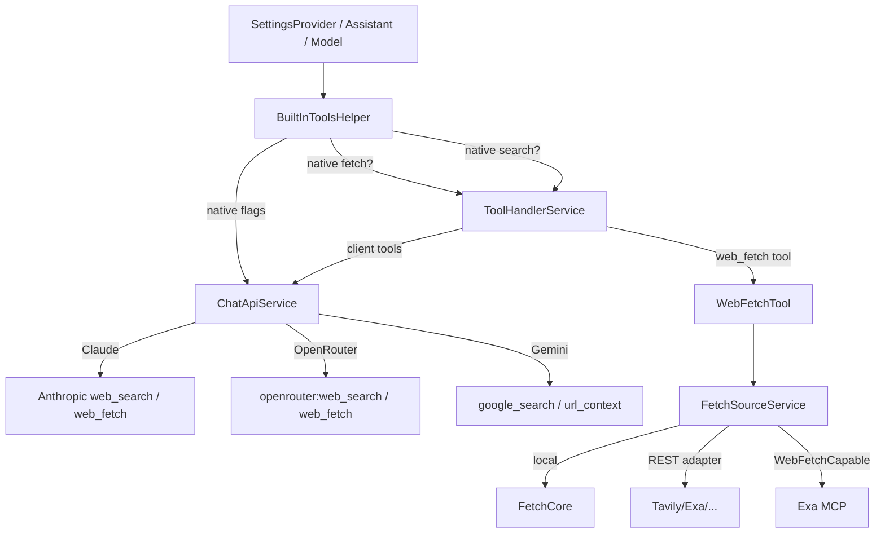

# OmniChat 網頁抓取擴充導入計畫

> **版本**：v1.0  
> **日期**：2026-11-03  
> **狀態**：Phase 0–7 實作與文件完成；實機／真實 API smoke 依指示略過，列入 release checklist  
> **範圍**：補齊 5 家搜尋／抓取 Provider（AnySearch、DeepSeek、Parallel、You.com、Exa MCP）＋ 3 種供應商原生 Fetch（Claude、OpenRouter、Gemini）  
> **非範圍**：JS render／內建瀏覽器、Exa MCP 的 Agent 工具（`agent_run`）、搜尋 UI 全面重構、語音工具路徑的完整功能對等、macOS／Linux／iOS 發佈驗收  
> **相關文件**：`OmniChat 專案開發與維護手冊.md` §3.4（搜尋）、§3.5（模型／原生工具）、§3.16（`web_fetch`）、§4（決策）、§5（陷阱）

---

## 實作現況（2026-11-03）

> 本節是實作完成後的回填，細節仍以各 Phase 與 §6–§9 的規格為準。

- **Phase 0–6 已完成**：`WebFetchCapable`、原生 Fetch 能力判定、工具 gating、`kelivo_fetch` alias、AnySearch／DeepSeek Search／Parallel／You.com／Exa MCP、Claude／OpenRouter 原生 `web_fetch`、Gemini `url_context` gating 與 metadata。
- **Phase 7 文件完成**：本文件、維護手冊 §3.4／§3.5／§3.16／§5.8／§7 已同步；UI 手動 smoke 與實機驗收依指示略過。
- **全域開關已接上**：`webFetchEnabled=false` 會同時抑制客戶端 `web_fetch`、Claude／OpenRouter server tool 與 Gemini `url_context`（主要文字與語音生成路徑）。AI Team／agent loop／OCR／翻譯等其他呼叫端目前未傳入此旗標，屬已知覆蓋缺口。
- **測試**：`flutter test` 全套通過（1,613 passed、1 skipped）；新增 `search_providers_expansion_test.dart`、`native_fetch_capability_test.dart`、`native_fetch_openrouter_test.dart`、`native_fetch_gating_test.dart`、`exa_mcp_test.dart`、`model_override_persistence_test.dart`。
- **未包含**：真實 API／實機 smoke（無金鑰）、Claude 官方端點的 request-level 串流測試、UI 手動驗收。
- **Exa MCP 錯誤處理**：`dependencies/mcp_client` 的 Streamable HTTP transport 對 HTTP ≥400 改回 JSON-RPC error，避免 request future 永不完結而卡到 timeout；keyless 403 仍取決於 Exa 端限制。
- **已知限制**：Gemini `url_context_metadata` 目前只在串流路徑解析，`stream:false` 的 `generateContent` 不回報 citation。
- **後續建議**：以真實金鑰驗證 5 家 Provider 與 3 種原生 Fetch；補 Claude `web_fetch_tool_result` SSE fixture 與 Gemini 非串流 metadata 測試；把 Phase 7 的 UI smoke 與 l10n 校對納入 release checklist。

---

## 0. 摘要（TL;DR）

本計畫分兩條工作流：

1. **Provider 廣度**：實作前 OmniChat 有 9 個 `ProviderFetchAdapter`、24 個 `SearchServiceOptions` 型別（UI type list 21；學術檢索走 Academic MCP）；本計畫補上 5 家缺少的 Provider：
   - **REST 型**：AnySearch、DeepSeek Search、Parallel、You.com（各自有 `/search` 與 `/extract`、`/fetch`、`/contents` 端點）。
   - **MCP 型**：Exa MCP（`https://mcp.exa.ai/mcp`，Streamable HTTP；不是一般 REST adapter，需新增 `WebFetchCapable` 路徑）。
2. **供應商原生 Fetch**：
   - **Claude**：新增 Anthropic `web_fetch` server tool（`builtInTools` 增加 `web_fetch`）。
   - **OpenRouter**：新增 `openrouter:web_fetch` server tool（chat-completions 路徑）。
   - **Gemini**：`url_context` **其實已經存在**（`BuiltInToolNames.urlContext`、`model_detail_sheet`、`chat_api_service` 皆有），本次不是新實作，而是把它納入統一的「原生 Fetch」能力判定、補齊 gating 與 `url_context_metadata` 的呈現。

**核心架構改動**：

- 新增 `WebFetchCapable` 介面，讓「抓頁」不再只能靠 `ProviderFetchAdapter` 的 REST 表；MCP／複雜 Provider 可以自己實作。
- 新增 `BuiltInToolsHelper` 的原生 Fetch 能力判定（`supportsNativeWebFetch`／`isNativeWebFetchEnabled`），並在所有工具組裝點（`tool_handler_service`、`chat_turn_service`、`message_builder_service`、`search_settings_sheet`）使用**同一個真相來源**。
- 原生 Fetch 開啟時，**不再向模型廣告客戶端 `web_fetch`**，避免兩個「讀網頁」工具打架；關閉時回復原本的 `web_fetch`。

**建議順序**：

```
Phase 0 能力判定／WebFetchCapable 基礎
  -> Phase 1 AnySearch + DeepSeek
  -> Phase 2 Parallel + You.com
  -> Phase 3 Exa MCP
  -> Phase 4 Claude native web_fetch
  -> Phase 5 OpenRouter native web_fetch
  -> Phase 6 Gemini url_context 稽核／統一
  -> Phase 7 UI／l10n／文件／驗收
```

**粗估工作量**：約 **23–31 人日**（單人 5–7 週；兩人可壓到 3–4 週，Phase 1／2 與 Phase 4／5 可平行）。

---

## 1. 現況盤點（As-Is）

### 1.1 分層與檔案

| 層 | 檔案 | 現況 |
|:---|:---|:---|
| 搜尋 Provider 註冊 | `lib/core/services/search/search_service.dart` | 24 個 `SearchServiceOptions` 型別；`SearchService.getService` 與 `SearchServiceOptions.fromJson` 都是大型 `switch`；尚無 `WebFetchCapable` 介面 |
| 搜尋調度 | `lib/core/services/search/search_dispatch.dart` | `fallback`／`round_robin`、429 冷卻、失效分類；新增 Provider 可直接受益 |
| 搜尋 Provider UI | `lib/features/search/pages/search_services_page.dart` | 2,842 行；`_buildServiceTypeList`、`_getServiceName`、`_getServiceIcon`、`_getServiceStatus`、`_BrandBadge._nameForService`、`_createService`、`_buildFieldsForType`、`_updateService` 都是逐 Provider 的 `switch`／`if` |
| 抓取 Adapter | `lib/core/services/web/provider_adapters.dart` | 9 個：Tavily／Exa／Firecrawl／Jina／LinkUp／Metaso／Querit／Tinyfish／Ollama；`ProviderFetchAdapter` 只支援 REST/JSON |
| 抓取來源解析 | `lib/core/services/web/fetch_source_service.dart` | `local`／`follow`／指定 Provider；`resolve()` 只認 `providerFetchAdapterFor(type)`；Provider 失敗回落 local |
| 抓取工具 | `lib/core/services/web/web_fetch_tool.dart` | 單一 `web_fetch`；aliases 有 `fetch_url`、`read_page`、`fetch_html`、`fetch_markdown`、`fetch_txt`、`fetch_json`，**沒有 `kelivo_fetch`** |
| 原生工具常數 | `lib/core/services/api/builtin_tools.dart` | `search`、`url_context`、`code_execution`、`youtube`、`code_interpreter`、`image_generation`；**沒有 `web_fetch`** |
| 原生工具注入 | `lib/core/services/api/chat_api_service.dart` | Claude：只有 `web_search`（`web_search_20250305`／動態版）；OpenRouter：只有 `plugins:[{'id':'web'}]`；Gemini：`google_search`／`url_context` 已存在 |
| 工具閘門 | `lib/features/home/services/tool_handler_service.dart`（約 184–193） | `search_web` 受 `hasBuiltInSearch` 抑制；`web_fetch` **只受全域 `webFetchEnabled` 控制，沒有原生 Fetch 判定** |
| 語音工具閘門 | `lib/core/services/chat/chat_turn_service.dart`（約 285–305、452） | 只加 `search_web`；`_hasBuiltInSearch` 仍是舊的 Google 1.5／gemini-pro 判斷 |
| 搜尋提示注入 | `lib/features/home/services/message_builder_service.dart`（約 600–610、740–755） | `hasBuiltInGeminiSearch` 只看 `builtInTools` 的 `search`，**沒看 `url_context`** |
| 原生工具 UI | `lib/features/search/widgets/search_settings_sheet.dart`、`lib/features/model/widgets/model_detail_sheet.dart` | 有內建搜尋／Google `url_context`／code execution／youtube 開關；沒有 Claude／OpenRouter 的原生 Fetch 開關 |
| 既有測試 | `test/builtin_tools_claude_dynamic_search_test.dart`、`test/openrouter_builtin_search_test.dart`、`test/web_fetch_*` | 已有能力矩陣與 request body 測試範式，可直接沿用 |

### 1.2 現有 Provider 與 Adapter 對照

| Provider | 搜尋 | 抓頁 Adapter | 備註 |
|:---|:---:|:---:|:---|
| Tavily | ✅ | ✅ `/extract` | 既有 |
| Exa | ✅ | ✅ `/contents` | 既有；`ExaOptions` 只有 `apiKey`，URL 硬編碼 |
| Firecrawl | ✅ | ✅ `/scrape` | 既有 |
| Jina | ✅ | ✅ `r.jina.ai` | 既有 |
| LinkUp | ✅ | ✅ `/v1/fetch` | 既有 |
| Metaso | ✅ | ✅ `/v1/reader` | 既有 |
| Querit | ✅ | ✅ `/v1/fetch` | 既有 |
| Tinyfish | ✅ | ✅ `/fetch` | 既有 |
| Ollama | ✅ | ✅ `/api/web_fetch` | 既有 |
| AnySearch | ❌ | ❌ | 本計畫 Phase 1 |
| DeepSeek Search | ❌（只有 chat Provider） | ❌ | 本計畫 Phase 1 |
| Parallel | ❌ | ❌ | 本計畫 Phase 2 |
| You.com | ❌ | ❌ | 本計畫 Phase 2 |
| Exa MCP | ❌ | ❌（需 MCP transport） | 本計畫 Phase 3 |

---

## 2. 缺口與前提校正

### 2.1 缺口表

| # | 缺口 | 現況 | 目標 | 工作流 |
|:---:|:---|:---|:---|:---|
| G1 | AnySearch | 完全沒有 | 搜尋＋`/v1/extract` 抓頁；API key 可選 | Phase 1 |
| G2 | DeepSeek Search | 只有 DeepSeek chat，沒有 Search／Fetch API | `/v1/tools/search`＋`/v1/tools/fetch` | Phase 1 |
| G3 | Parallel | 完全沒有 | `/v1/search`＋`/v1/extract` | Phase 2 |
| G4 | You.com | 完全沒有 | `/v1/search`＋`/v1/contents` | Phase 2 |
| G5 | Exa MCP | 完全沒有 | MCP `web_search_exa`／`web_fetch_exa` | Phase 3 |
| G6 | Claude 原生 Fetch | 只有原生 `web_search` | `web_fetch` server tool | Phase 4 |
| G7 | OpenRouter 原生 Fetch | 只有 `plugins:[{'id':'web'}]` 搜尋 | `openrouter:web_fetch` server tool | Phase 5 |
| G8 | Gemini 原生 Fetch | `url_context` **已存在**，但 gating／metadata 不完整 | 統一能力判定＋`url_context_metadata` 呈現 | Phase 6 |
| G9 | `kelivo_fetch` 別名 | alias map 沒有 | 加一行 alias，舊提示詞／舊對話可路由 | Phase 0（順帶） |

### 2.2 前提校正（重要）

1. **Gemini `url_context` 不是缺口，是「已存在但沒被統一管理」**  
   `BuiltInToolNames.urlContext`、`model_detail_sheet` 的 Google 開關、`chat_api_service` 的 `{'url_context': {}}` 注入（`generateContent` 非串流／串流／第二條路徑）都在。真正的問題是：
   - `message_builder_service.hasBuiltInGeminiSearch` 只看 `search`，不看 `url_context`；
   - `chat_turn_service._hasBuiltInSearch` 仍是舊的硬編碼；
   - client `web_fetch` 沒有被 `url_context` 抑制；
   - `url_context_metadata` 沒有被解析成 citations／工具卡。  
   本計畫把它列為 Phase 6 的「稽核＋統一」，**不要重複實作**。修正時要保留 Gemini 的 built-in-only 語義：`url_context` 單獨開啟也會讓 Gemini 丟棄 function declarations，因此 client `search_web` 與 `web_fetch` 都應抑制；不要把 Claude／OpenRouter 的「只抑制對應工具」規則套到 Gemini。

2. **Claude 的 `web_fetch_20250910` 不一定是最新穩定版**  
   Kelivo v1.3.4 的常數是：
   - `claudeFetchToolTypeBasic = 'web_fetch_20250910'`
   - `claudeFetchToolTypeDynamic = 'web_fetch_20260318'`  
   但 Anthropic 現行 API reference 列出的是 `web_fetch`／`web_fetch_20251119`（stable），以及 `web_fetch_20260209`／`_20260309`／`_20260318`（beta）；`_20250910` 未出現在目前 reference。  
   **本計畫決策**：預設送 stable `web_fetch`；`_20260318` 只在確認 beta header 與模型支援後作為 per-model override；`_20250910` 僅保留為 kelivo 相容的 legacy 常數，不設為預設。

3. **Exa MCP 不是「再加一列 adapter」**  
   `ProviderFetchAdapter` 假設一次 HTTP request／response；Exa MCP 需要 `initialize` → `tools/call` 的 MCP session（`mcp_client` 的 `StreamableHttpClientTransport`）。因此必須新增 `WebFetchCapable` 或專用 source，不能只改 `_adapters` 表。

4. **`kelivo_fetch` 別名缺失**  
   `WebFetchTool.aliases` 有 kelivo 舊版 4 工具與 `fetch_url`，但沒有 kelivo 現行 MCP 工具名 `kelivo_fetch`。這是 Phase 0 的一行修正，讓舊提示詞／舊對話不會斷。

5. **`web_fetch` 與原生 Fetch 的關係**  
   原生 Fetch 是 provider-side server tool，不是第二個客戶端工具。開啟時應**抑制客戶端 `web_fetch` 的 schema**；但 handler 仍保留，讓舊對話／舊工具呼叫可以執行（與 `search_web` 的既有做法一致）。

---

## 3. 設計原則

| # | 原則 | 說明 |
|:---:|:---|:---|
| D1 | **單一客戶端工具** | 模型端永遠只有一個 `web_fetch`；不新增 `fetch_url`、`kelivo_fetch` 等第二個 schema。舊名只做 handler alias。 |
| D2 | **單一能力真相來源** | 原生搜尋／原生 Fetch／客戶端工具是否出現，一律由 `BuiltInToolsHelper` 判定；不要在 4 個呼叫點各寫一份。 |
| D3 | **REST 用表、MCP 用介面** | 簡單 Provider 繼續用 `ProviderFetchAdapter` 宣告式表；MCP／需要 session 的 Provider 實作 `WebFetchCapable`。 |
| D4 | **原生 Fetch 預設關閉** | 依模型 `builtInTools` opt-in；預設不改變既有使用者行為。 |
| D5 | **原生開啟即抑制客戶端** | 避免模型同時看到兩個「讀網頁」工具；使用者要 fallback 就先關原生。 |
| D6 | **成本與隱私可見** | 原生 Fetch／Tier-2 都會把 URL 送到第三方；UI 必須明示，且不在 log 印出 key（既有 `RequestLogger` 已 redact `authorization`／`x-api-key`／`api-key`）。 |
| D7 | **加法式相容** | 新 Provider 型別只新增 JSON `type`；不改舊資料格式；舊版 App 遇到未知型別仍回落 `BingLocalOptions`（既有行為，文件註明）。 |
| D8 | **本計畫不做 JS render** | 動態頁面仍走 Provider extract／既有 Tier-2；內建瀏覽器是另一個量級的獨立計畫。 |

---

## 4. 目標架構

### 4.1 搜尋 Provider 層

新增 5 個 `SearchServiceOptions` 子類與對應 `SearchService`：

```
SearchServiceOptions.fromJson
  ├─ anysearch   -> AnySearchOptions
  ├─ deepseek    -> DeepSeekSearchOptions
  ├─ parallel    -> ParallelOptions
  ├─ you         -> YouSearchOptions
  └─ exa_mcp     -> ExaMcpOptions
```

`SearchService.getService` 同步新增 5 個 case。UI 的 type list／name／icon／status／create／update／fields 也同步新增。

> **UI 結構決策**：本計畫**不**先做 `SearchProviderDescriptor` 全面重構，避免功能變更與 UI 重構混在一起。5 家 Provider 沿用既有 `switch` 模式；若後續還要再加 5 家，再另開重構計畫（見 §16 待決問題）。

### 4.2 抓取來源層

新增介面（建議放在 `lib/core/services/search/search_service.dart` 或獨立 `web_fetch_capable.dart`）：

```dart
abstract interface class WebFetchCapable<T extends SearchServiceOptions> {
  Future<WebFetchPage> fetch({
    required String url,
    required SearchCommonOptions commonOptions,
    required T serviceOptions,
  });
}
```

`FetchSourceService` 的解析改成：

```dart
bool supports(SearchServiceOptions options) {
  final type = (options.toJson()['type'] ?? '').toString();
  if (providerFetchAdapterFor(type) != null) return true;
  return SearchService.getService(options) is WebFetchCapable;
}

Future<WebFetchOutcome> fetch(...) async {
  final adapter = resolved.adapter;
  if (adapter != null) {
    // 既有 REST 路徑
  } else if (service is WebFetchCapable) {
    final page = await service.fetch(
      url: request.url.toString(),
      commonOptions: settings.searchCommonOptions,
      serviceOptions: options,
    );
    // 轉成 FetchResult（標題／內容／截斷）
  }
}
```

這樣 AnySearch／DeepSeek／Parallel／You 可以只用 adapter；Exa MCP 用 `WebFetchCapable`；未來其他 MCP Provider 也沿用同一條路。

**`ResolvedFetchSource` 的必要修正**：

- 目前 `isLocal => adapter == null || options == null`；capability source 會是 `adapter == null` 但 `options != null`，會被誤判成 local。必須改成 `adapter == null && options == null`。
- `resolve()` 目前遇到沒有 adapter 的 type 直接回 `ResolvedFetchSource.local()`；必須先檢查 `SearchService.getService(options) is WebFetchCapable`，是的話回一個 capability source（`adapter = null`、`options = options`、`source` 用 service 名稱）。
- capability 分支必須和 REST 分支一樣：先過 `SsrfGuard.check`（Provider 讀取永不允許私有位址，即使 local 已允許），失敗時回落 local，並帶 `escalated: true`／`escalationError`；不可只呼叫 `service.fetch()` 就回傳。
- `allowEscalation == false` 時（raw／POST／自訂 header 等不可升級請求）不要嘗試 capability provider，直接走 local。

### 4.3 原生 Fetch 層

```
ProviderConfig + modelId + modelOverrides[modelId].builtInTools
        │
        ▼
BuiltInToolsHelper
  ├─ supportsNativeWebSearch(...)
  ├─ supportsNativeWebFetch(...)
  ├─ isNativeWebFetchEnabled(...)
  └─ claudeBuiltInFetchToolType(...)
        │
        ├─► ToolHandlerService.buildToolDefinitions
        │     search_web  : searchEnabled && !nativeSearch
        │     web_fetch   : webFetchEnabled && !nativeFetch
        │
        └─► ChatApiService（provider-specific）
              Claude     : tools += web_fetch server tool
              OpenRouter : tools += openrouter:web_fetch
              Gemini     : tools += url_context（既有）
```

### 4.4 請求流程（文字對話）



---

## 5. 分階段工作計畫

### Phase 0：能力判定與 `WebFetchCapable` 基礎（3–4 人日）

**目標**：先讓「原生 Fetch」與「MCP 抓頁」有地方掛，避免每個 Provider 各自改 gating。

| 工作 | 檔案 | 內容 |
|:---|:---|:---|
| 0.1 `WebFetchCapable` | `lib/core/services/search/search_service.dart`（或新檔） | 新增介面；`FetchSourceService` 支援 adapter／capability 兩條路 |
| 0.2 原生 Fetch 常數 | `lib/core/services/api/builtin_tools.dart` | `BuiltInToolNames.webFetch = 'web_fetch'`；`normalize('webfetch')`；`orderedForStorage` 加入 |
| 0.3 能力判定 | 同上 | `supportsNativeWebFetch`、`isNativeWebFetchEnabled`、`claudeBuiltInFetchToolType`；`BuiltInToolsState` 增加 `webFetchActive` |
| 0.4 工具閘門 | `tool_handler_service.dart`、`chat_turn_service.dart` | `web_fetch` 條件改為 `settings.webFetchEnabled && !hasNativeFetch && supportsTools`；`hasNativeFetch` 由 helper 計算。Phase 0 只讓 Claude／OpenRouter 生效；Gemini 在 Phase 6 才切換，避免 Phase 0 就改變既有 `url_context` 使用者行為 |
| 0.5 Gemini built-in 判定 | `message_builder_service.dart` | 將 `hasBuiltInGeminiSearch` 擴充／改名為 `hasGeminiBuiltInTools`（`search`／`url_context`／`code_execution` 任一），用來抑制 Gemini 的 client `search_web`／`web_fetch`；**不要**把它當成通用 `hasBuiltInSearch`，Claude／OpenRouter 走各自的 native flags |
| 0.6 alias | `web_fetch_tool.dart` | aliases 加 `'kelivo_fetch': toolName` |
| 0.7 測試 | `test/web_fetch_gating_test.dart`、`test/native_fetch_capability_test.dart` | 既有 Provider 行為不變；無原生 Fetch 時 `web_fetch` 仍出現；helper 矩陣正確 |
| 0.8 override 保存 | `model_detail_sheet.dart`、`test/model_override_persistence_test.dart` | `model_detail_sheet._save` 目前用顯式 key 清單重建 `modelOverrides[modelId]`，只 pass-through `oauthProtocol`／`source`／`oauthAccountId`／`reasoningSynced`／`reasoningWire`；新增的 `webFetch`（以及既有的 `webSearch`）會在模型頁存檔時被默默丟掉。**必須**把 `prev['webSearch']`／`prev['webFetch']` 明確帶回，並加回歸測試 |

**驗收**：`flutter test` 既有測試全綠；新增矩陣測試；Claude／OpenRouter 尚無使用者，Gemini 行為不變（Phase 6 才切換）；`webSearch`／`webFetch` 在模型頁存檔後仍存在。

---

### Phase 1：AnySearch + DeepSeek（3–4 人日）

| 工作 | 檔案 | 內容 |
|:---|:---|:---|
| 1.1 Options | `search_service.dart` | `AnySearchOptions`（`apiKey` 可空、`zone`、`language`、`url` 可空）；`DeepSeekSearchOptions`（`apiKey`） |
| 1.2 Services | `providers/anysearch_search_service.dart`、`providers/deepseek_search_service.dart` | 搜尋實作＋錯誤映射（見 §6） |
| 1.3 Fetch adapters | `provider_adapters.dart` | `anysearch` → `/v1/extract`；`deepseek` → `/v1/tools/fetch` |
| 1.4 Registry/UI | `search_service.dart`、`search_services_page.dart` | 5 個 switch／if 點＋表單欄位 |
| 1.5 l10n | 4 個 ARB | 名稱、描述、欄位、狀態 |
| 1.6 測試 | `test/search_providers_anysearch_test.dart`、`test/search_providers_deepseek_test.dart`、`test/provider_adapters_new_fetch_test.dart` | 搜尋／抓頁／錯誤／cap |

**驗收**：可在搜尋服務頁新增兩家；可測試連線；可被 `web_fetch_source=follow` 選中；AnySearch 無 key 時可用（受免費限額）。

---

### Phase 2：Parallel + You.com（3–4 人日）

| 工作 | 檔案 | 內容 |
|:---|:---|:---|
| 2.1 Options | `search_service.dart` | `ParallelOptions`（`apiKey`、`mode`：`fast` 預設、`turbo`／`basic`／`advanced`）；`YouSearchOptions`（`apiKey`、`contentMode`：`highlights` 預設／`snippets`） |
| 2.2 Services | `providers/parallel_search_service.dart`、`providers/you_search_service.dart` | 搜尋實作＋錯誤映射 |
| 2.3 Fetch adapters | `provider_adapters.dart` | `parallel` → `/v1/extract`；`you` → `/v1/contents` |
| 2.4 UI/l10n/tests | 同上 | mode／contentMode 選擇器；`test/search_providers_parallel_test.dart`、`test/search_providers_you_test.dart` |

**驗收**：Parallel 預設 `fast`（成本／延遲平衡）；You 預設 `highlights`；兩者都可抓頁。

---

### Phase 3：Exa MCP（4–5 人日）

| 工作 | 檔案 | 內容 |
|:---|:---|:---|
| 3.1 Options | `search_service.dart` | `ExaMcpOptions`（`apiKey` 可空、`url` 預設 `https://mcp.exa.ai/mcp`） |
| 3.2 Service | `providers/exa_mcp_search_service.dart` | `SearchService<ExaMcpOptions>`＋`WebFetchCapable<ExaMcpOptions>`；MCP helper |
| 3.3 解析器 | 同上 | `web_search_exa` 的 `Title:`／`URL:`／`Published:`／`Author:` 解析；`web_fetch_exa` 的 `# Title`／`URL:` 解析 |
| 3.4 Registry/UI | `search_service.dart`、`search_services_page.dart` | 新增 `exa_mcp`；API key 可空、URL 進階欄位 |
| 3.5 測試 | `test/exa_mcp_test.dart` | 以本地 fake MCP server／fixture 測搜尋、抓頁、keyless 403、429、空結果 |

**驗收**：無 key 可在直接 IPv4 環境使用（受免費限額）；有 key 走帳號限額；proxy／IPv6 的 403 有明確錯誤訊息；不影響既有 Exa（直連）。

---

### Phase 4：Claude 原生 `web_fetch`（3–4 人日）

| 工作 | 檔案 | 內容 |
|:---|:---|:---|
| 4.1 常數／helper | `builtin_tools.dart` | `webFetch`、`isOfficialAnthropicEndpoint`、`supportsClaudeWebFetchForModel`、`claudeBuiltInFetchToolType`、`claudeFetchMaxContentTokens`（預設 30000）。注意：OmniChat 目前**沒有** `isOfficialAnthropicEndpoint`，且既有 `supportsBuiltInSearchForModel` 對 Claude 也沒檢查 host（`web_search` 目前會送到 Claude-compatible relay）；本計畫先為 `web_fetch` 加嚴格 gating，`web_search` 的同類問題另開工作項 |
| 4.2 請求注入 | `chat_api_service.dart`（Claude tools 區塊，約 6900） | `allTools += {type, name:'web_fetch', max_content_tokens, max_uses?, allowed_domains?, blocked_domains?}` |
| 4.3 串流解析 | `chat_api_service.dart`（約 7360–7430） | `server_tool_use` name=`web_fetch`、`web_fetch_tool_result`、`web_fetch_tool_result_error`；轉成 `web_fetch` 工具卡／citation |
| 4.4 Gating | `tool_handler_service.dart` | Claude 原生開啟時抑制 client `web_fetch` |
| 4.5 UI | `search_settings_sheet.dart`（主要）、`model_detail_sheet.dart`（選配） | 開關＋`max_content_tokens`／`max_uses`／domains 進階設定；成本提示。`model_detail_sheet` 目前沒有 Claude 的 built-in tools 分支，若要做捷徑需新增 branch；本計畫以搜尋設定頁為主 |
| 4.6 測試 | `test/native_fetch_claude_test.dart`、`test/native_fetch_gating_test.dart` | request body 有 `web_fetch`；DeepSeek-compatible 不注入；client tool 被抑制；錯誤卡 |

**驗收**：官方 Anthropic 端點可用；Claude-compatible／DeepSeek Claude 不送 server tool；預設 stable `web_fetch`，beta 只在 override 時使用。

---

### Phase 5：OpenRouter 原生 `web_fetch`（2–3 人日）

| 工作 | 檔案 | 內容 |
|:---|:---|:---|
| 5.1 能力判定 | `builtin_tools.dart` | `isOpenRouterProvider(cfg) && cfg.useResponseApi != true` |
| 5.2 請求注入 | `chat_api_service.dart`（body 組裝約 3327–3340；不是 3410 的 `plugins` 區塊） | `body['tools'] += {'type':'openrouter:web_fetch','parameters':{...}}`；`body['tools']` 可能為 null，需建清單並依 `type` 去重；保留既有 function tools |
| 5.3 參數 | 同上 | `engine`（可空）、`max_uses`、`max_content_tokens`、`allowed_domains`、`blocked_domains` |
| 5.4 與搜尋外掛區隔 | 同上 | `plugins:[{'id':'web'}]` 是搜尋；`openrouter:web_fetch` 是讀指定 URL；不要互相覆寫 |
| 5.5 UI/l10n/tests | `search_settings_sheet.dart`、`app_*.arb` | 開關＋成本提示（主要放搜尋設定頁；`model_detail_sheet` 的 OpenAI 分支不適合直接塞 OpenRouter server tool）；`test/native_fetch_openrouter_test.dart` |

**驗收**：chat-completions 路徑有 server tool；Responses 路徑不注入；`plugins` 搜尋行為不變；client `web_fetch` 被抑制。

---

### Phase 6：Gemini `url_context` 稽核與統一（1–2 人日）

| 工作 | 檔案 | 內容 |
|:---|:---|:---|
| 6.1 能力判定 | `builtin_tools.dart`、`tool_handler_service.dart` | `isNativeWebFetchEnabled` 對 Google 回傳 `builtInTools.contains(urlContext)`；抑制 client `web_fetch` |
| 6.2 搜尋提示 | `message_builder_service.dart`、`chat_turn_service.dart` | Gemini 的 `hasGeminiBuiltInTools` 納入 `url_context`（一併抑制 client `search_web`／`web_fetch`）；`chat_turn_service._hasBuiltInSearch` 改用 helper／modelOverrides；Claude／OpenRouter 仍走各自 native flags |
| 6.3 metadata | `chat_api_service.dart`（約 8916） | 解析 `url_context_metadata`（`retrieved_url`／`url_retrieval_status`），轉成 citation／工具卡 |
| 6.4 UI 文案 | `model_detail_sheet.dart`、`search_settings_sheet.dart` | `model_detail_sheet` 的既有開關標成「原生 Fetch（URL context）」；`search_settings_sheet` 只顯示狀態／說明，**不新增第二個開關**，避免重複 |
| 6.5 測試 | `test/native_fetch_gemini_url_context_test.dart` | request body 有 `{'url_context':{}}`；無 `function_declarations`；metadata 解析；client tool 抑制 |

**驗收**：`url_context` 與 `google_search` 可並存；`code_execution` 仍為 exclusive；`url_context` 開啟時 client `web_fetch` 不再出現；既有 Gemini 測試全綠。

---

### Phase 7：UI／l10n／文件／驗收（4–5 人日）

| 工作 | 內容 |
|:---|:---|
| 7.1 Provider UI | 5 家 type list／name／icon／status／brand badge；新增/編輯/刪除/測試連線 round-trip |
| 7.2 原生 Fetch UI | 開關、進階參數、成本／隱私提示、「client `web_fetch` 已隱藏」說明 |
| 7.3 l10n ×4 | `app_en.arb`、`app_zh.arb`、`app_zh_Hans.arb`、`app_zh_Hant.arb`；`flutter gen-l10n` |
| 7.4 文件 | 更新手冊 §3.4／§3.5／§3.16／§4；手冊 §7 加入本文件連結；本文件保留為實作依據 |
| 7.5 全套測試 | `flutter analyze`、`flutter test`、目標區域 widget tests |
| 7.6 手動 smoke | 見 §11.3 矩陣 |

---

## 6. 各 Provider 規格

> 以下 API 規格依 2026-11 官方文件整理；發布前請再確認一次定價／限額。  
> 共同原則：`SearchCommonOptions.resultSize` 預設 10；各 Provider 依官方上限 clamp，不讓 UI 設定直接送出超限值。

### 6.1 AnySearch

| 項目 | 內容 |
|:---|:---|
| `type` | `anysearch` |
| 搜尋 | `POST https://api.anysearch.com/v1/search` |
| 認證 | `Authorization: Bearer <key>`；**key 可空**（匿名走 per-IP 免費額度） |
| Request | `{query, max_results: clamp(resultSize, 1, 10), format: 'json', zone?: 'cn'／'intl', language?}` |
| Response | `{code, message, request_id, data:{results:[{title,url,snippet,content}], metadata}}`；`code == 0` 才算成功 |
| 抓頁 | `POST https://api.anysearch.com/v1/extract`，body `{url}`；回 `data.{url,title,content}` |
| 錯誤 | `code != 0` → 帶 `message`／`request_id`；422 = 無法萃取；429 = rate limit |
| 限額 | Free：1,000 calls/day、10 QPS；Pro：$3/1K（限時，定價頁為準）、20 QPS |
| UI 欄位 | API Key（可空）、Zone（intl／cn）、Language（可空） |
| 注意 | 官方文件 `max_results` 上限是 **10**；kelivo 目前 clamp 到 20，OmniChat 應以官方 10 為準 |

### 6.2 DeepSeek Search

| 項目 | 內容 |
|:---|:---|
| `type` | `deepseek` |
| 搜尋 | `POST https://api.deepseek.com/v1/tools/search` |
| 認證 | `Authorization: Bearer <DeepSeek API Key>` |
| Request | `{query, count: clamp(resultSize, 1, 50), need_content: false}` |
| Response | `{results:[{title,url,snippet,summary,content,date,site_name,...}]}`；`summary` 是給模型看的長摘要，`snippet` 是 UI 用 |
| 文字映射 | `summary` 非空用 `summary`，否則 `snippet`；若 `date` 是 UTC，前置 `[Published: YYYY-MM-DD]` |
| 抓頁 | `POST https://api.deepseek.com/v1/tools/fetch`，body `{url}` → `{title, content}`（Markdown） |
| 錯誤 | OpenAI 風格 error envelope；429 = QPS 超限 |
| 限額 | $0.75/1K successful search／fetch；Search 100 QPS、Fetch 25 QPS（帳號層級）；失敗不計費 |
| UI 欄位 | API Key |
| 注意 | 這是 **Search／Fetch API**，不是 chat completions；不要跟 DeepSeek chat Provider 混用 |

### 6.3 Parallel

| 項目 | 內容 |
|:---|:---|
| `type` | `parallel` |
| 搜尋 | `POST https://api.parallel.ai/v1/search` |
| 認證 | **`x-api-key: <key>`**（不是 Bearer） |
| Request | `{objective: query, search_queries:[query], mode, advanced_settings:{max_results: clamp(1,20), excerpt_settings:{max_chars_per_result: 10000}}}` |
| Mode | `turbo`／`fast`（建議預設）／`basic`／`advanced`；官方預設 advanced，但成本較高 |
| Response | `{results:[{url,title,publish_date,excerpts:[...]}]}`；文字 = `excerpts.join('\n\n')` |
| 抓頁 | `POST https://api.parallel.ai/v1/extract`，body `{urls:[url], advanced_settings:{full_content:true, excerpt_settings:{max_chars_per_result: 100000}}}`；回 `results[0].full_content`（fallback `excerpts`） |
| 錯誤 | `errors[]`／`error_type`／`http_status_code`；429 = rate limit |
| 限額 | Search $1/1K（turbo/fast）或 $5/1K（basic/advanced）；Extract $1/1K URLs；600 req/min |
| UI 欄位 | API Key、Mode 選擇器 |
| 注意 | v1 的 `full_content`／`fetch_policy`／`excerpt_settings` 必須放在 `advanced_settings` 內；放 top-level 會 422 |

### 6.4 You.com

| 項目 | 內容 |
|:---|:---|
| `type` | `you` |
| 搜尋 | `POST https://ydc-index.io/v1/search` |
| 認證 | **`X-API-Key: <key>`** |
| Request | `{query, count: clamp(resultSize, 1, 100), extraction?: {extraction_mode: 'highlights'}}`；`contentMode == snippets` 時不加 extraction |
| Response | `{results:{web:[...], news:[...]}, metadata}`；文字優先 `contents.highlights`，其次 `snippets`，最後 `description` |
| 抓頁 | `POST https://ydc-index.io/v1/contents`，body `{urls:[url], formats:['markdown','metadata']}` → `[{url,title,markdown,...}]` |
| 錯誤 | 429 帶 `Retry-After`；`api.you.com` 與 `ydc-index.io` 路徑不同，Search／Contents 用 `ydc-index.io` |
| 限額 | Search $5/1K；頁面 $1/1K（live）／cache 免費；10 req/s |
| UI 欄位 | API Key、Content Mode（highlights／snippets） |
| 注意 | `count` 上限 100；`highlights.count` 上限 50，超過 422 |

### 6.5 Exa MCP

| 項目 | 內容 |
|:---|:---|
| `type` | `exa_mcp` |
| Endpoint | `https://mcp.exa.ai/mcp`（Streamable HTTP） |
| 認證 | `x-api-key` **可空**；無 key 走免費限額（需直接 IPv4，proxy／IPv6 會 403） |
| 搜尋工具 | `web_search_exa`，args `{query, numResults}`；回文字含 `Title:`／`URL:`／`Published:`／`Author:` |
| 抓頁工具 | `web_fetch_exa`，args `{urls:[url], maxCharacters: 100000}`；回 `# Title`／`URL:` 開頭的 Markdown |
| MCP client | `StreamableHttpClientTransport.create(baseUrl, headers, timeout, terminateOnClose:false)` → `Client(name:'OmniChat', version, requestTimeout)` → `connect` → `callTool` → `dispose`／`close` |
| 錯誤 | keyless 429 是免費 MCP 限額；403 多半是 proxy／IPv6；MCP `isError` 或純文字錯誤都要保留 |
| 限額 | 無 key：官方只說 free rate limit（未公布數字；第三方稱 3 QPS／150 次/日，僅供參考）；有 key：帳號方案 |
| UI 欄位 | API Key（可空）、Endpoint（進階，預設 `https://mcp.exa.ai/mcp`） |
| 注意 | OmniChat 的 `mcp_client` 沒有 `setRequestTimeout`；用 constructor `requestTimeout`＋`.timeout()`。每次呼叫建一個 session，避免跨請求共享狀態。429 要映射成 `FetchSourceService` 既有的 `_ProviderRateLimited`（或等價訊號），否則不會進入 Provider 冷卻、會一直重試 |

---

## 7. 原生 Fetch 規格

### 7.1 Claude `web_fetch`

| 項目 | 內容 |
|:---|:---|
| 能力旗標 | `builtInTools` 加入 `web_fetch` |
| Tool entry | `{type: <version>, name: 'web_fetch', max_content_tokens: 30000, max_uses?: N, allowed_domains?: [...], blocked_domains?: [...]}` |
| 版本 | 預設 **stable `web_fetch`**（或 `web_fetch_20251119`）；per-model override 可選 `web_fetch_20260318`（beta，**必須送對應 `anthropic-beta` header**，實作前確認）；`web_fetch_20250910` 僅作 kelivo legacy 相容。任何 pinned beta 版本若沒帶 beta header 都會 400，別把它誤判成 gating 問題 |
| 站點限制 | **只限官方 Anthropic 端點**（`api.anthropic.com` 或空 baseUrl）；Claude-compatible／DeepSeek-Claude／自訂 relay 一律不送 |
| `max_content_tokens` | 預設 30000（kelivo 同值）；per-model 可調，**App 政策**夾在 1024–200000（Anthropic 文件只規定 min 1）；不套用到 PDF 等二進位內容（Anthropic 行為） |
| `max_uses` | 可空；建議 UI 上限 20 |
| Domains | `allowed_domains`／`blocked_domains` 可空；寫入前 trim／去空／去重 |
| Citations | 預設關閉；若要開，需確認回應 citation block 的 UI 呈現 |
| 串流解析 | `server_tool_use`（name `web_fetch`）→ 工具卡；`web_fetch_tool_result` → 內容卡；`web_fetch_tool_result_error` → 錯誤卡 |
| 失敗策略 | 單次 fetch 失敗不中斷整輪；把錯誤碼呈現在工具卡，模型可改抓別頁 |

**Request 範例**：

```json
{
  "tools": [
    {"type": "web_fetch", "name": "web_fetch", "max_content_tokens": 30000}
  ]
}
```

### 7.2 OpenRouter `openrouter:web_fetch`

| 項目 | 內容 |
|:---|:---|
| 能力旗標 | `builtInTools` 加入 `web_fetch` |
| Tool entry | `{"type": "openrouter:web_fetch", "parameters": {...}}`，放在一般 `tools` 陣列。注入點是 chat-completions 的 body 組裝（約 3327–3340），不是 3410 的 `plugins` 區塊；`body['tools']` 可能為 `null`，需建立清單並依 `type` 去重（chat-completions 沒有 Responses 路徑的 `addResponsesBuiltInTool` 等價 helper） |
| 參數 | `engine`（可空；例如 `exa`）、`max_uses`、`max_content_tokens`、`allowed_domains`、`blocked_domains` |
| 路徑 | 只支援 chat-completions；`useResponseApi == true` 時不注入 |
| 與搜尋的差別 | `plugins:[{'id':'web'}]` 是**搜尋**外掛（已 deprecated）；`openrouter:web_fetch` 是**讀指定 URL** 的 server tool |
| 回應 | 由 OpenRouter 回傳 server tool 結果／annotations；實作前先以真實 key 確認是否有獨立 tool result block，再決定 UI 呈現 |
| 成本 | 由 OpenRouter 依 fetch 計費；UI 顯示「由 OpenRouter 計費」，不硬編數字 |
| 失敗策略 | 400「tool not supported」→ 提示使用者關閉原生 Fetch；不要在未告知下自動退回 client tool |

### 7.3 Gemini `url_context`（既有，Phase 6 稽核）

| 項目 | 內容 |
|:---|:---|
| 現況 | `BuiltInToolNames.urlContext`、`model_detail_sheet` 開關、`chat_api_service` 的 `{'url_context': {}}` 已存在 |
| 請求 | `tools: [{'google_search': {}}, {'url_context': {}}]` 可並存；`code_execution` 仍 exclusive |
| URL 來源 | 由 prompt 文字內的 URL 決定；不是 tool args |
| 回應 metadata | `candidates[0].url_context_metadata` 內含 `url_metadata[]`（`retrieved_url`／`url_retrieval_status`） |
| 待補 | `hasGeminiBuiltInTools` 納入 `url_context`（一併抑制 client `search_web`／`web_fetch`）；metadata 轉 citation／工具卡 |
| UI | 既有 Google URL context 開關改名／加說明；不要新增第二個 `web_fetch` 開關 |

---

## 8. 能力判定與工具閘門矩陣

### 8.1 Helper 契約

```dart
static bool supportsNativeWebFetch({
  required ProviderConfig? cfg,
  required String? modelId,
});

static bool isNativeWebFetchEnabled({
  required ProviderConfig? cfg,
  required String? modelId,
});

static String claudeBuiltInFetchToolType({
  required ProviderConfig? cfg,
  required String? modelId,
});
```

`supportsNativeWebFetch` 規則：

| ProviderKind | 條件 |
|:---|:---|
| `google` | 一律 true（`url_context`） |
| `claude` | 官方 Anthropic 端點；排除 DeepSeek／自訂 relay |
| `openai` / `neuralwatt` | `isOpenRouterProvider(cfg) && cfg.useResponseApi != true` |
| 其他 | false |

`isNativeWebFetchEnabled`：

- Google：`builtInTools.contains(urlContext)`
- Claude／OpenRouter：`builtInTools.contains(webFetch)` 且 `supportsNativeWebFetch`
- 其他：false

**不要**把 `webFetchActive` 加進 `BuiltInToolsState.anyMcpConflictingToolActive`。Claude／OpenRouter 的 server tool 可以與 function／MCP tools 並存；只有 Gemini 的 `search`／`url_context`／`code_execution` 會讓 function declarations 失效，那段衝突邏輯維持既有 `urlContextActive`／`searchActive`／`codeExecutionActive` 判定即可。

### 8.2 工具矩陣

| 原生搜尋 | 原生 Fetch | 客戶端 `search_web` | 客戶端 `web_fetch` |
|:---:|:---:|:---:|:---:|
| ✗ | ✗ | `searchEnabled` 時出現 | `webFetchEnabled` 時出現 |
| ✓ | ✗ | 不出現 | `webFetchEnabled` 時出現 |
| ✗ | ✓ | `searchEnabled` 時出現 | 不出現 |
| ✓ | ✓ | 不出現 | 不出現 |

**注意**：

- **上表是 Claude／OpenRouter／OpenAI 型 Provider 的語義**：原生 Fetch 只抑制 `web_fetch`，原生搜尋只抑制 `search_web`。
- **Gemini 是例外**：`google_search`／`url_context`／`code_execution` 任一開啟，Gemini API 會忽略 function declarations；因此 client `search_web` 與 `web_fetch` **都要抑制**。這正是 Phase 0.5 的 `hasGeminiBuiltInTools` 存在的原因。
- Gemini `url_context` 屬於「原生 Fetch ✓」；`google_search` 屬於「原生搜尋 ✓」。`url_context` 開啟但 `google_search` 關閉時，仍然不廣告 `search_web`（因為 function declarations 已被 Gemini 丟棄）。
- 若 `code_execution` 開啟，Gemini 只送 `code_execution`，其他 built-in 與 function declarations 都不送（既有行為）。
- 客戶端 `web_fetch` 只是不廣告 schema；handler 仍保留，舊對話／舊 tool call 可執行。
- 原生 Fetch 失敗時**不自動**切換到客戶端工具（避免同一輪重複抓取與計費）；由使用者關閉原生或模型改抓別頁。

---

## 9. 設定與資料模型

### 9.1 `builtInTools`

沿用 `modelOverrides[modelId]['builtInTools']`：

```json
["search", "web_fetch", "url_context"]
```

`BuiltInToolNames.orderedForStorage` 建議順序：

```dart
const preferredOrder = <String>[
  BuiltInToolNames.search,
  BuiltInToolNames.webFetch,
  BuiltInToolNames.urlContext,
  BuiltInToolNames.codeExecution,
  BuiltInToolNames.youtube,
  BuiltInToolNames.codeInterpreter,
  BuiltInToolNames.imageGeneration,
];
```

### 9.2 `webFetch` 進階設定

```json
{
  "webFetch": {
    "toolVersion": "web_fetch",
    "maxContentTokens": 30000,
    "maxUses": 5,
    "allowedDomains": ["docs.example.com"],
    "blockedDomains": ["private.example.com"],
    "citations": false,
    "engine": "exa"
  }
}
```

| 欄位 | 適用 | 規則 |
|:---|:---|:---|
| `toolVersion` | Claude | 預設 `web_fetch`；可選 `web_fetch_20260318`（beta，需驗證）；`web_fetch_20250910` 僅 legacy |
| `maxContentTokens` | Claude／OpenRouter | App 政策夾在 1024–200000（Anthropic 只規定 min 1）；預設 30000 |
| `maxUses` | Claude／OpenRouter | App 政策 1–20；空＝供應商預設 |
| `allowedDomains`／`blockedDomains` | Claude／OpenRouter | trim／去空／去重；空陣列不送 |
| `citations` | Claude | 預設 false；開啟前確認 UI 支援 |
| `engine` | OpenRouter | 可空；例 `exa`；不硬編 |

讀寫規則：

- 讀取時逐欄寬鬆解析；型別錯誤忽略該欄，回退預設。
- 寫入時 read-modify-write `webFetch` map，**不得覆蓋** `webSearch`／`reasoning`／`apiModelId` 等其他 key。建議直接重用 `search_settings_sheet._setClaudeDynamicWebSearchEnabled` 的 read-modify-write 模式，不要另寫一套。
- **`model_detail_sheet._save` 的陷阱**：它目前用顯式 key 清單重建 `modelOverrides[modelId]`（`final next = <String, dynamic>{...}`），只 pass-through `oauthProtocol`／`source`／`oauthAccountId`／`reasoningSynced`／`reasoningWire`；`webSearch` 與新增的 `webFetch` 都不在清單內，會在模型頁存檔時被默默丟掉。Phase 0.8 必須把兩者明確帶回，並加 `test/model_override_persistence_test.dart`。
- 不新增 SharedPreferences 全域鍵；`provider_configs_v1` 已包含 `modelOverrides`，隨備份同步。
- `webFetchEnabledKey`（`web_fetch_enabled_v1`）仍是客戶端工具的全域開關；原生 Fetch 的 precedence 見 §16。

**全域 precedence 的實作建議**：`ChatApiService` 目前只拿 `ProviderConfig`／`modelId`，沒有 `SettingsProvider`；不要讓它直接讀取全域設定。建議在 `MessageGenerationService`／`ChatTurnService` 呼叫 API 前，用一個 `SettingsProvider.effectiveBuiltInToolsForModel(providerKey, modelId)`（或等價 helper）產生 effective set：`webFetchEnabled == false` 時移除 `web_fetch`／`url_context`，再把這個 set 以 optional parameter 傳給 `ChatApiService`。這樣 global master switch 與 per-model opt-in 不會各說各話。

### 9.3 相容性

- 新 Provider 只新增 `type`；舊版 App 的 `SearchServiceOptions.fromJson` 會 fallback 到 `BingLocalOptions`（既有行為）。文件註明「降級後該 Provider 會變成 Bing Local，不會 crash」。
- `builtInTools` 新增 `web_fetch` 對舊版 App 是未知字串；`parseAndNormalize` 會保留但舊版 `getActiveTools` 不會使用，安全。
- 不需要資料遷移。

---

## 10. UI／UX

### 10.1 搜尋服務頁

新增 5 家 Provider 到：

- `_buildServiceTypeList`（type list）
- `_getServiceName`
- `_getServiceIcon`
- `_getServiceStatus`
- `_BrandBadge._nameForService`（沒有 brand asset 就用字母 badge）
- `_createService`
- `_buildFieldsForType`
- `_updateService`

表單欄位：

| Provider | 欄位 |
|:---|:---|
| AnySearch | API Key（可空）、Zone（intl／cn）、Language（可空） |
| DeepSeek | API Key |
| Parallel | API Key、Mode（fast 預設） |
| You.com | API Key、Content Mode（highlights／snippets） |
| Exa MCP | API Key（可空）、Endpoint（進階） |

### 10.2 原生 Fetch 區塊

在 `search_settings_sheet.dart` 的「內建搜尋」下方新增「內建網頁讀取」：

- 開關：`hasNativeWebFetch`（Claude／OpenRouter）。Google 的 URL context 開關仍在 `model_detail_sheet`；此頁只顯示目前狀態與說明，不重複第二個開關。
- 副標：
  - 「由 <Provider> 代為讀取，URL 會送到該供應商。」
  - 「開啟後客戶端 `web_fetch` 會隱藏，避免重複工具。」
  - 成本提示（Claude／OpenRouter 依供應商計費；Gemini 依 token）。
- 進階：`max_content_tokens`、`max_uses`、allowed／blocked domains、citations、engine。
- **不要**在開啟原生 Fetch 時呼叫 `setWebFetchEnabled(false)`（那是全域，會影響其他模型）；只寫 per-model `builtInTools`。

`model_detail_sheet.dart` 的 built-in tools 區塊：

- Google：既有 URL context 開關保留，文案改「原生網頁讀取（URL context）」。
- Claude／OpenRouter：目前沒有 built-in tools 分支。本計畫**不強制**在此新增 `web_fetch` 開關；主要入口是 `search_settings_sheet`。若要做模型頁捷徑，需新增 `ProviderKind.claude`／OpenRouter 的 branch，並確認不影響既有 OpenAI 分支的 code interpreter／image generation 開關。

### 10.3 對話呈現

- `web_fetch` 工具卡沿用既有卡片，來源徽章顯示 `Local`／`Provider`／`Claude`／`OpenRouter`／`Gemini`。
- Claude `web_fetch_tool_result` 轉成 `web_fetch` 工具卡（URL、狀態、內容摘要）。
- OpenRouter：先以真實回應確認是否有 tool result block；若只有 annotations，走 citation 呈現。
- Gemini `url_context_metadata`：新增 citation／工具卡，顯示 `retrieved_url` 與 `url_retrieval_status`；失敗的 URL 也要顯示，不要靜默丟棄。
- `process_group_logic`：原生 Fetch 卡是否納入「過程收褶」由既有規則決定；`builtin_search` 目前隱藏，`web_fetch` 不隱藏。

---

## 11. 測試計畫

### 11.1 單元／整合測試

| 測試檔 | 覆蓋 |
|:---|:---|
| `test/search_providers_expansion_test.dart` | AnySearch／DeepSeek Search／Parallel／You.com 的 request body／header／clamp／response mapping、4 個新 adapter、options round-trip |
| `test/exa_mcp_test.dart` | MCP handshake、`web_search_exa`／`web_fetch_exa`、文字解析、capability dispatch、403 指引、isError／quota |
| `test/native_fetch_capability_test.dart` | `supportsNativeWebFetch`／`isNativeWebFetchEnabled` 矩陣、Claude tool version／beta header、storage order |
| `test/native_fetch_openrouter_test.dart` | `tools` 有 `openrouter:web_fetch`、Responses 不送、`plugins` 獨立、global `webFetchEnabled` 抑制 |
| `test/native_fetch_gating_test.dart` | 四象限矩陣；Claude／OpenRouter／Gemini 原生讀頁抑制客戶端 `web_fetch`／`search_web` |
| `test/model_override_persistence_test.dart` | `webSearch`／`webFetch` 在 `model_detail_sheet` 存檔後仍存在（Phase 0.8 回歸） |

**尚未補的自動化測試**（需真實 API 或更完整的 fixture）：Claude `web_fetch` request body／SSE 串流、Gemini `url_context_metadata` 串流與非串流解析、搜尋服務頁新增／編輯／刪除 widget test。`test/settings_provider_search_services_test.dart` 的 Provider type round-trip 目前只由 `search_providers_expansion_test.dart` 覆蓋 options 層；`SettingsProvider` 的 prune／seed／dangling-id 行為仍未測。

測試範式：

- 沿用 `test/openrouter_builtin_search_test.dart` 的本地 `HttpServer` 擷取 request body。
- MCP 用 fake transport／本地 Streamable HTTP server；不要把真實 key 放進 CI。
- 所有 fixture 從官方文件範例簡化，放在測試檔內或 `test/fixtures/`。

### 11.2 靜態檢查

```bash
flutter analyze
flutter test
flutter gen-l10n   # 若 ARB 有變更
```

### 11.3 手動 Smoke Matrix

| 場景 | 預期 |
|:---|:---|
| AnySearch 無 key 搜尋／抓頁 | 成功（免費限額內）；429 有可讀錯誤 |
| AnySearch 有 key | 成功；不洩漏 key |
| DeepSeek Search／Fetch | 成功；`need_content=false` 不抓大內容 |
| Parallel fast／advanced | 成功；mode 正確；extract `full_content` |
| You highlights／snippets | 成功；count > 100 被 clamp |
| Exa MCP 無 key（direct IPv4） | 成功；proxy／IPv6 出現 403 指引 |
| Exa MCP 有 key | 成功；429 顯示方案限額 |
| Claude 官方 + native fetch | request 有 `web_fetch`；client `web_fetch` 不在 tools；工具卡正常 |
| Claude-compatible／DeepSeek | 不送 `web_fetch`；client `web_fetch` 仍可用 |
| OpenRouter chat-completions | `tools` 有 `openrouter:web_fetch`；`plugins` 搜尋仍正常 |
| OpenRouter Responses | 不送 native fetch |
| Gemini `url_context` | `tools` 有 url_context；無 function declarations；metadata 卡正常 |
| Gemini `google_search + url_context` | 兩者並存；client 搜尋／fetch 都被抑制 |
| 全域 `webFetchEnabled` 關閉 | 客戶端 `web_fetch` 不出現；原生 Fetch 行為見 §16 決策 |

---

## 12. 遷移與相容性

| 項目 | 策略 |
|:---|:---|
| 既有 9 個 Provider | 不動；只新增 adapter 分支 |
| 既有 `web_fetch` 使用者 | 預設行為不變；原生 Fetch 預設關閉 |
| 既有 `fetch_url`／`read_page` 等 alias | 保留；新增 `kelivo_fetch` |
| 既有備份 | 不需遷移；新 Provider 型別向後相容 |
| 舊版 App 讀到新 Provider | `fromJson` fallback 到 Bing Local（既有行為）；文件註明 |
| 舊版 App 讀到 `web_fetch` flag | 忽略；不 crash |
| 搜尋調度 | 新 Provider 自動支援 fallback／round-robin／429 冷卻 |
| 語音路徑 | 本計畫只確保 gating 一致；是否加 `web_fetch` 工具另開工作項 |
| Gemini `url_context` 既有使用者 | Phase 6 起 client `web_fetch` 會被抑制；這是行為變更，需在 release notes／手冊 §3.16 明示「要 client 抓頁請先關 URL context」 |
| `webSearch` 既有資料 | Phase 0.8 一併修正 `model_detail_sheet` 存檔丟失問題；若使用者已在搜尋設定頁設定 `webSearch`，模型頁存檔後不應消失（回歸測試） |

---

## 13. 風險與緩解

| # | 風險 | 影響 | 緩解 |
|:---:|:---|:---|:---|
| R1 | Provider API 欄位／路徑漂移 | 搜尋或抓頁失敗 | 以官方文件為準；fixture 測試；錯誤訊息保留 provider body 摘要 |
| R2 | Auth header 寫錯（Bearer vs `x-api-key` vs `X-API-Key`） | 401／403 | 每個 adapter 獨立 header builder；測試斷言 header |
| R3 | 結果數超限（AnySearch 10／Parallel 20／You 100） | 400 或靜默截斷 | 統一 `clampResults`；UI 顯示實際上限 |
| R4 | Exa MCP keyless 走 proxy／IPv6 | 403 | 錯誤訊息明示「需 direct IPv4 或 API key」；UI 建議填 key |
| R5 | Exa MCP 文字格式變動 | 解析失敗 | 保留原始文字 fallback；fixture 覆蓋；錯誤不要吞 |
| R6 | Claude `web_fetch` 版本／beta header 不相容 | 400 | 預設 stable；beta 只做 override；400 顯示「關閉原生 Fetch」指引 |
| R7 | Claude-compatible relay 不支援 server tools | 400 | `isOfficialAnthropicEndpoint` 嚴格 gating |
| R8 | OpenRouter `plugins` 與 server tool 衝突 | 搜尋或 fetch 失效 | 先實測共存；必要時 Phase 5 後另開「`plugins` → `openrouter:web_search`」遷移 |
| R9 | 原生 Fetch 與 client `web_fetch` 同時出現 | 模型選錯、重複計費 | 統一 gating；四象限測試 |
| R10 | Gemini `url_context` 已存在但被重複實作 | 重複工具／請求錯誤 | Phase 6 先稽核；不新增第二個開關 |
| R11 | `url_context_metadata` 形狀與猜測不同 | citation 不顯示 | 以真實回應 fixture 為準；先做 defensive parse |
| R12 | UI 2,842 行開關新增 5 家 | 回歸風險 | 只動列出的函式；widget test round-trip；不混入 descriptor 重構 |
| R13 | 成本／隱私提示不足 | 使用者意外付費 | 每個原生／Tier-2 開關顯示「URL 會送到供應商」與計費提示 |
| R14 | 舊備份降級 | Provider 變 Bing | 文件註明；不刪未知 JSON；必要時保留原始 map |

---

## 14. 排程與工作量

| Phase | 交付 | 人日 | 依賴 |
|:---|:---|:---:|:---|
| 0 | `WebFetchCapable`＋能力判定＋alias | 3–4 | 無 |
| 1 | AnySearch＋DeepSeek | 3–4 | Phase 0 |
| 2 | Parallel＋You.com | 3–4 | Phase 0（可與 Phase 1 平行） |
| 3 | Exa MCP | 4–5 | Phase 0 |
| 4 | Claude native `web_fetch` | 3–4 | Phase 0 |
| 5 | OpenRouter native `web_fetch` | 2–3 | Phase 0（可與 Phase 4 平行） |
| 6 | Gemini `url_context` 稽核 | 1–2 | Phase 0 |
| 7 | UI／l10n／文件／驗收 | 4–5 | 全部 |
| **合計** | | **23–31 人日** | |

**日曆估算**：

- 單人：5–7 週（含 buffer）。
- 兩人：3–4 週；建議分工：
  - A：Phase 0 → 1 → 2 → 3（Provider／MCP）
  - B：Phase 0 → 4 → 5 → 6（native fetch）→ 與 A 一起做 Phase 7

---

## 15. 驗收標準（Definition of Done）

1. **Provider**
   - 5 家 Provider 都能在搜尋服務頁新增／編輯／刪除／測試連線。
   - 都能執行搜尋，結果數不超過官方上限。
   - 都能作為 `web_fetch` 的來源（`follow` 或指定 Provider）。
   - 錯誤（401／403／422／429／timeout）都有可讀訊息，且 429 會進入冷卻。
2. **Exa MCP**
   - 無 key（direct IPv4）與有 key 都能用。
   - proxy／IPv6 403 有明確指引。
   - MCP 文字解析有 fixture；格式變動時保留原始文字 fallback。
3. **原生 Fetch**
   - Claude 官方端點：request 有 `web_fetch`；client `web_fetch` 被抑制；工具卡／錯誤卡正常。
   - Claude-compatible／DeepSeek：不送 `web_fetch`；client `web_fetch` 仍可用。
   - OpenRouter chat-completions：request 有 `openrouter:web_fetch`；Responses 不送；`plugins` 搜尋不受影響。
   - Gemini：`url_context` 與 `google_search` 可並存；metadata 有呈現；client `web_fetch` 被抑制。
4. **測試**
   - `flutter analyze` 無新增 warning／error。
   - `flutter test` 全綠（含既有 `web_fetch_*`、`search_dispatch`、Claude／OpenRouter 測試）。
   - 新增測試覆蓋 §11.1 全部檔案。
5. **文件**
   - 手冊 §3.4／§3.5／§3.16／§4 更新。
   - 本文件與實作一致；已知限制寫在 §16／風險表。

---

## 16. 待決問題（Open Questions）

| # | 問題 | 建議 |
|:---:|:---|:---|
| Q1 | 原生 Fetch 預設 ON 還是 OFF？ | **OFF**；per-model opt-in，避免成本與模型差異 |
| Q2 | 全域 `web_fetch_enabled_v1` 關閉時，原生 Fetch 是否也關？ | **是**（master switch）；依 §9.2 的 `effectiveBuiltInToolsForModel` 在呼叫 API 前剝除 `web_fetch`／`url_context`，再以 optional parameter 傳給 `ChatApiService` |
| Q3 | 原生 Fetch 開啟時，是否保留 client `web_fetch` 作 fallback？ | **不保留**；要 fallback 就先關原生。未來可加「進階：保留 client fallback」 |
| Q4 | Claude 預設 tool version？ | **stable `web_fetch`**；`web_fetch_20260318` 需 beta header 驗證後才開放 override；`_20250910` 僅 legacy |
| Q5 | OpenRouter 是否順便把 `plugins:web` 遷到 `openrouter:web_search`？ | **另開工作項**；本計畫只加 `openrouter:web_fetch`，避免混合變更 |
| Q6 | Exa MCP 要放搜尋 Provider 還是 MCP Server 頁？ | **搜尋 Provider**（與 kelivo 一致）；這樣才能參與 `web_fetch` 來源解析與搜尋調度 |
| Q7 | Parallel 預設 mode？ | **fast**（$1/1K、~700ms）；advanced 由使用者選 |
| Q8 | AnySearch 預設 zone？ | **intl**；中文使用者可選 cn |
| Q9 | UI 是否要做 `SearchProviderDescriptor` 重構？ | **本計畫不做**；5 家沿用既有 switch；第 6 家以後再開重構 |
| Q10 | 是否要在語音路徑加 `web_fetch`？ | **本計畫不做**；只統一 gating，功能對等另開工作項 |
| Q11 | 第三方 MCP 若也叫 `web_fetch`，是否會與客戶端工具撞名？ | OmniChat 目前沒有 kelivo 那種 `BuiltInToolNames.all` reserved set；實作前確認 `mcp_tool_service` 的命名／碰撞處理，必要時把 `web_fetch` 加入保留名單 |

---

## 附錄 A：API 速查表

| Provider | 搜尋 | 認證 | 抓頁 | 上限／限額 |
|:---|:---|:---|:---|:---|
| AnySearch | `POST https://api.anysearch.com/v1/search` | `Authorization: Bearer`（可空） | `POST /v1/extract` | `max_results` 1–10；Free 1,000/day、10 QPS |
| DeepSeek | `POST https://api.deepseek.com/v1/tools/search` | `Authorization: Bearer` | `POST /v1/tools/fetch` | `count` 1–50；100／25 QPS；$0.75/1K |
| Parallel | `POST https://api.parallel.ai/v1/search` | `x-api-key` | `POST /v1/extract` | `max_results` 1–20；600/min；$1–5/1K |
| You.com | `POST https://ydc-index.io/v1/search` | `X-API-Key` | `POST /v1/contents` | `count` 1–100；10 req/s；$5/1K |
| Exa MCP | MCP `web_search_exa` | `x-api-key`（可空） | MCP `web_fetch_exa` | keyless free rate limit；direct IPv4 |
| Exa（既有） | `POST https://api.exa.ai/search` | `Authorization: Bearer` | `POST /contents` | 既有 |
| Claude native | server tool `web_fetch` | Anthropic key／OAuth | server-side | 30k content tokens 預設 |
| OpenRouter native | server tool `openrouter:web_fetch` | OpenRouter key | server-side | 依 OpenRouter 計費 |
| Gemini native | `url_context` | Google key／Vertex | server-side | 依 token 計費 |

### 官方文件

- AnySearch：<https://www.anysearch.com/docs>、</docs/api-endpoints/v1-search>、</docs/api-endpoints/v1-extract>
- DeepSeek：<https://api-docs.deepseek.com/guides/search/>、<https://api-docs.deepseek.com/api/search/>、<https://api-docs.deepseek.com/api/fetch/>
- Parallel：<https://docs.parallel.ai/search/search-quickstart>、<https://docs.parallel.ai/extract/extract-quickstart>
- You.com：<https://you.com/docs/guides/search>、<https://you.com/docs/guides/contents>
- Exa MCP：<https://exa.ai/docs/get-started/exa-mcp>、<https://github.com/exa-labs/exa-mcp-server>
- Anthropic web fetch：<https://platform.claude.com/docs/en/api/messages>
- OpenRouter web fetch：<https://openrouter.ai/docs/guides/features/server-tools/web-fetch>
- Gemini URL context：<https://ai.google.dev/gemini-api/docs/generate-content/url-context>

---

## 附錄 B：檔案級變更清單

### 核心

- `lib/core/services/search/search_service.dart`
- `lib/core/services/search/providers/anysearch_search_service.dart`（新）
- `lib/core/services/search/providers/deepseek_search_service.dart`（新）
- `lib/core/services/search/providers/parallel_search_service.dart`（新）
- `lib/core/services/search/providers/you_search_service.dart`（新）
- `lib/core/services/search/providers/exa_mcp_search_service.dart`（新）
- `lib/core/services/web/provider_adapters.dart`
- `lib/core/services/web/fetch_source_service.dart`
- `lib/core/services/web/web_fetch_tool.dart`
- `lib/core/services/api/builtin_tools.dart`
- `lib/core/services/api/chat_api_service.dart`
- `dependencies/mcp_client/lib/src/transport/streamable_http_transport.dart`（vendored patch：HTTP ≥400 回 JSON-RPC error；同步上游時需保留）
- `lib/core/providers/settings_provider.dart`（搜尋服務的清單正規化／selected prune；確認沒有 type 白名單會擋新 Provider）
- `lib/features/home/services/tool_handler_service.dart`
- `lib/core/services/chat/chat_turn_service.dart`
- `lib/features/home/services/message_builder_service.dart`
- `lib/features/home/services/message_generation_service.dart`
- `lib/features/home/controllers/generation_controller.dart`

### UI／l10n

- `lib/features/search/pages/search_services_page.dart`（含 `_testConnection`）
- `lib/features/search/widgets/search_settings_sheet.dart`
- `lib/features/model/widgets/model_detail_sheet.dart`
- `lib/features/chat/widgets/chat_message_widget.dart`（原生 Fetch 卡／citation）
- `lib/features/chat/widgets/message_export_sheet.dart`（既有 `web_fetch`／`builtin_search` case 的匯出對齊）
- `lib/features/chat/widgets/process_group_logic.dart`（若需要）
- `lib/l10n/app_en.arb`
- `lib/l10n/app_zh.arb`
- `lib/l10n/app_zh_Hans.arb`
- `lib/l10n/app_zh_Hant.arb`
- `lib/l10n/app_localizations*.dart`（`flutter gen-l10n`）

### 文件

- `docs/fetch_provider_expansion_plan.md`（本文件）
- `OmniChat 專案開發與維護手冊.md` §3.4／§3.5／§3.16／§4

### 測試

- `test/search_providers_anysearch_test.dart`
- `test/search_providers_deepseek_test.dart`
- `test/search_providers_expansion_test.dart`
- `test/exa_mcp_test.dart`
- `test/native_fetch_capability_test.dart`
- `test/native_fetch_openrouter_test.dart`
- `test/native_fetch_gating_test.dart`
- `test/model_override_persistence_test.dart`

---

## 附錄 C：l10n 鍵值草案

| Key | 用途 |
|:---|:---|
| `searchServiceNameAnySearch` | Provider 名稱 |
| `searchServiceNameDeepSeek` | Provider 名稱 |
| `searchServiceNameParallel` | Provider 名稱 |
| `searchServiceNameYou` | Provider 名稱 |
| `searchServiceNameExaMcp` | Provider 名稱 |
| `searchProviderAnySearchDescription` | 說明 |
| `searchProviderDeepSeekDescription` | 說明 |
| `searchProviderParallelDescription` | 說明 |
| `searchProviderYouDescription` | 說明 |
| `searchProviderExaMcpDescription` | 說明（key 可空） |
| `searchServicesPageAnySearchZone` | Zone 欄位 |
| `searchServicesPageParallelMode` | Mode 欄位 |
| `searchServicesPageYouContentMode` | Content mode 欄位 |
| `searchSettingsSheetBuiltinWebFetchTitle` | 原生 Fetch 開關 |
| `searchSettingsSheetBuiltinWebFetchSubtitle` | URL 會送到供應商 |
| `searchSettingsSheetBuiltinWebFetchCostNote` | 計費提示 |
| `searchSettingsSheetNativeFetchHidesClientTool` | 客戶端工具已隱藏 |
| `searchSettingsSheetWebFetchMaxTokens` | 進階欄位 |
| `searchSettingsSheetWebFetchMaxUses` | 進階欄位 |
| `searchSettingsSheetWebFetchDomains` | 進階欄位 |
| `modelDetailSheetWebFetchTool` | 模型頁開關 |
| `modelDetailSheetClaudeWebFetchDescription` | 說明 |
| `modelDetailSheetOpenRouterWebFetchDescription` | 說明 |
| `modelDetailSheetGeminiUrlContextDescription` | 說明 |
| `webFetchNativeUnsupported` | 不支援的錯誤 |
| `webFetchNativeBetaWarning` | beta 版本警告 |
| `exaMcpKeylessProxyWarning` | keyless 403 指引 |

---

## 附錄 D：Kelivo 參考實作

| 檔案 | 用途 |
|:---|:---|
| `lib/core/services/search/providers/anysearch_search_service.dart` | AnySearch 搜尋／extract |
| `lib/core/services/search/providers/deepseek_search_service.dart` | DeepSeek Search／Fetch |
| `lib/core/services/search/providers/parallel_search_service.dart` | Parallel Search／Extract |
| `lib/core/services/search/providers/you_search_service.dart` | You Search／Contents |
| `lib/core/services/search/providers/exa_mcp_search_service.dart` | Exa MCP 搜尋／fetch |
| `lib/core/services/api/builtin_tools.dart` | Claude／OpenRouter／Gemini 原生工具注入與能力判定 |

Kelivo 相關 commit：

- `301ab809`：新增 in-memory fetch MCP
- `92db9a4e`：Fetch MCP token efficiency（4 工具合併為 1）
- `5e2dd4d7`：`kelivo_fetch` 支援 POST
- `c36135c0`：新增 `fetch_url`／搜尋 Provider 抓頁
- `c193d506`：v1.3.3 提示使用者關閉重複的內建 fetch

> 注意：Kelivo 的 `web_fetch_20250910` 與 `max_results` clamp 20 是其實作現況，不代表官方最新規格；本計畫以官方文件與實測為準。
