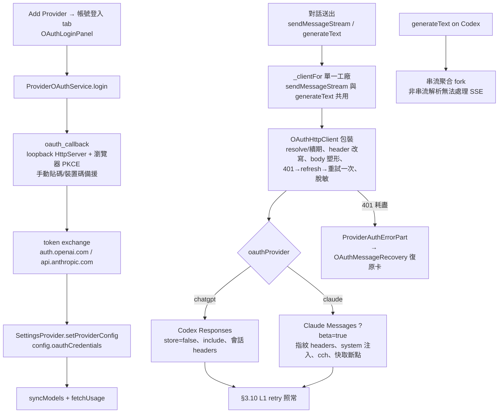

# OmniChat Provider OAuth 登入導入計畫（ChatGPT / Claude / Grok / Kimi Code 訂閱帳號）

> **版本**：v1.4（2026-11-01：M5.5 Android 原生登入與 M6 Grok/Kimi 落地，見 §5 M5.5/M6；v1.3 為二次審查修訂，見 §11.1 #15–18）
> **日期**：2026-11-01
> **上游對照**：[Chevey339/kelivo](https://github.com/Chevey339/kelivo) @ `05eef503b6e7cda14de897373b79bab7bebe35b9`（2026-10-30；2026-11-01 錨定，見 §10.1）；上游設計文件 `docs/provider-oauth.md`
> **關聯手冊章節**：§2（架構）、§3.5（多模型適配）、§3.10（串流容錯）、§3.11（工具重放）、§5.3（API 協議規範）、§5.7（`_localOnlyKeys`）、§7.3（C-S01 金鑰儲存決策）

---

## 目錄

1. [目的與範圍](#1-目的與範圍)
2. [上游實作調查結論](#2-上游實作調查結論)
3. [OmniChat 現況盤點](#3-omnichat-現況盤點)
4. [目標架構與決策](#4-目標架構與決策)
5. [分階段實作計畫](#5-分階段實作計畫)
6. [關鍵契約與陷阱](#6-關鍵契約與陷阱)
7. [安全與合規風險](#7-安全與合規風險)
8. [測試計畫](#8-測試計畫)
9. [裁示紀錄](#9-裁示紀錄)
10. [附錄：上游版本錨定、授權與檔案對照](#10-附錄上游版本錨定授權與檔案對照)
11. [Review 修訂紀錄](#11-review-修訂紀錄)

---

## 1. 目的與範圍

### 1.1 目標

導入上游 Kelivo 的 **Provider OAuth 帳號登入**：使用者以 **ChatGPT（Codex）** 或 **Claude（Pro / Max）** 訂閱帳號完成 OAuth 登入後，直接以該帳號的額度使用對應模型（GPT-5.x / Codex 系列、Claude 全系列），**無需輸入 API key**。App 負責：

- 瀏覽器 PKCE 授權流程（含 callback 接收）；
- access token 自動續期（refresh token）；
- 帳號可用模型的同步（`syncModels`）；
- 用量/額度顯示（ChatGPT 5 小時與週窗口、Claude 5 小時/週/各模型窗口）；
- 對話請求以訂閱端點的專屬協定塑形（Codex Responses API、Claude Code 指紋 headers）。

### 1.2 範圍

| 項目 | 本期（Phase 1） | 後續（Phase 2，本計畫僅預留） |
|:--|:--|:--|
| OAuth 供應商 | **ChatGPT（Codex）**、**Claude**、**Grok**、**Kimi Code**（M6 已於 2026-11-01 落地） | — |
| 平台 | **Windows**（loopback HttpServer）、**Android**（loopback + **M5.5 原生 Custom Tabs/AuthTab + deep link**，2026-11-01 落地） | 實機驗收 |
| 模型能力 | 對話、工具呼叫、推理檔位、多輪重放——全部沿用現有管線 | — |
| MCP OAuth 系統瀏覽器流程 | 不做；但 callback 基礎設計為共用，日後 MCP OAuth 可重用 | 另案 |

### 1.3 非目標（明確排除）

- **iOS / macOS / Linux**：非 OmniChat 發佈平台（手冊 §3.18 §6），callback 基礎設計時保留跨平台形狀，但不驗收。
- **自建帳號系統**：OmniChat 無中心化伺服器的立場不變；OAuth 憑證只存本機。
- **供應商端點的穩定性保證**：ChatGPT/Claude 訂閱端點屬非公開 API（上游同此），變動風險見 §7。

---

## 2. 上游實作調查結論

> 以下為上游 commit `05eef50`（2026-11-01 錨定，見 §10.1）的濃縮結論，作為移植藍圖。上游提供四個 OAuth 供應商 `OAuthProvider { chatgpt, grok, kimi, claude }`——**Claude OAuth 完整存在**（README 英文版 Getting Started 未列 Claude 僅為文案過時；`docs/provider-oauth.md` 與 `claude_oauth_adapter.dart` 測試均可證）。

### 2.1 檔案地圖（上游 → 職責）

| 上游檔案 | 職責 |
|:--|:--|
| `lib/core/models/provider_oauth.dart` | `OAuthProvider` enum（baseUrl/clientId/tokenEndpoint/scope 常數）、`ProviderOAuthCredentials`（token 持久化結構）、用量窗口模型、JWT claims 解碼 |
| `lib/core/services/auth/provider_oauth_service.dart` | 單例服務：login/logout、憑證持久化、**併發續期合併**、401 強制續期重試一次、模型同步、usage 快取、`_ProviderOAuthHttpClient`（把憑證接進 ChatApiService 的包裝 client） |
| `lib/core/services/auth/provider_oauth_adapter.dart` | 抽象 adapter + ChatGPT/Grok/Kimi 實作：device-code 流程、token 交換、JWT 解析、usage 解析、錯誤脫敏、`OAuthWire` |
| `lib/core/services/auth/claude_oauth_adapter.dart` | Claude 專屬（`part of`）：PKCE + 手動貼碼登入、token 刷新（JSON body）、分頁模型列表、usage 解析、bootstrap 取帳號/組織資訊 |
| `lib/core/services/auth/claude_oauth_request.dart` | Claude Code 指紋偽裝層：headers、system 注入、工具名 `_` 前綴、`metadata.user_id`、max_tokens 夾限、快取斷點、XXHash64 `cch`、`claude_code_version_too_old` 自動升級重試 |
| `lib/core/services/auth/codex_request.dart` | Codex Responses 請求塑形：`store=false`、`stream=true`、剝取樣參數、`include: reasoning.encrypted_content`、routing/residency header、工具配對修復 |
| `lib/core/services/auth/oauth_callback*.dart` | 共用（MCP + 供應商）callback：桌面 loopback HttpServer；Android/iOS 經 MethodChannel `app.oauth`；PKCE 產生器；取消原語 |
| `lib/core/services/api/provider_request_headers.dart` | 會話 headers：ChatGPT `session_id`/`conversation_id`/`x-client-request-id`；Claude `X-Claude-Code-Session-Id` |
| `lib/features/provider/widgets/oauth_login_panel.dart` 等 UI | 登入面板、帳號詳情頁、用量卡（90% 轉紅）、聊天中 401 復原卡 |

### 2.2 ChatGPT（Codex）關鍵常數

| 項目 | 值 |
|:--|:--|
| client_id | `app_EMoamEEZ73f0CkXaXp7hrann` |
| 授權端點 | `https://auth.openai.com/oauth/authorize`（PKCE S256、`originator=kelivo`、`codex_cli_simplified_flow=true`）**注**：Spike E 若確認 `originator=omnichat` 可用，此處與請求 header 一起改 |
| redirect_uri | `http://localhost:1455/auth/callback`（**固定**，桌面與 Android 同） |
| Token 端點 | `https://auth.openai.com/oauth/token`（form-encoded） |
| 對話 baseUrl | `https://chatgpt.com/backend-api/codex`（**Responses API**、強制流式） |
| 備用：裝置碼流程 | `POST /api/accounts/deviceauth/usercode` → 使用者碼頁 `auth.openai.com/codex/device` → 輪詢 `deviceauth/token`（最多 120 次） |
| 請求 headers | `Authorization: Bearer`、`chatgpt-account-id`（自 JWT claims）、`originator`、`version: 0.159.0`、`OpenAI-Beta: responses=experimental`、`User-Agent` |
| 會話 headers | `session_id` / `conversation_id` / `x-client-request-id`；JWT claims → `x-openai-internal-codex-residency`、`x-codex-routing-hint` |
| 模型同步 | `GET {base}/models?client_version=<ver>`；濾 `visibility=hide/hidden`；`supported_in_api:false` **不**排除；按 `priority` 排序 |
| 用量 | `GET https://chatgpt.com/backend-api/wham/usage`（`rate_limit.primary_window/secondary_window.used_percent/reset_at`、`plan_type`）＋ `.../rate-limit-reset-credits` |
| 版本追蹤 | `oauthModelsClientVersion` 記住同步時的 Codex 版本；啟動時版本不符即重同步 |

### 2.3 Claude 關鍵常數

| 項目 | 值 |
|:--|:--|
| client_id | `9d1c250a-e61b-44d9-88ed-5944d1962f5e`（Claude Code CLI 官方 id） |
| 授權端點 | `https://claude.ai/oauth/authorize`（PKCE S256、`code=true`、scope `org:create_api_key user:profile user:inference user:sessions:claude_code user:mcp_servers user:file_upload`） |
| redirect_uri | `http://localhost:54545/callback`（**固定**；port 占用 → ephemeral fallback）；回呼 deadline **5 分鐘** |
| Token 端點 | `https://api.anthropic.com/v1/oauth/token`——**JSON body**（非 form）；refresh 同；header `anthropic-beta: oauth-2025-04-20` |
| 手動貼碼備援 | 接受：純 code、`code=...&state=...`、`code#state`、完整回調 URL；帶 state 必須匹配 |
| 對話 baseUrl | `https://api.anthropic.com/v1`（**Anthropic Messages 原生協定**）；`/v1/messages` 追加查詢參數 **`?beta=true`** |
| 請求 headers | `Authorization: Bearer`（**移除** `x-api-key`）、`anthropic-version: 2023-06-01`、多項 `anthropic-beta`（`claude-code-20250219, oauth-2025-04-20, interleaved-thinking-2025-05-14, …`）、`anthropic-dangerous-direct-browser-access: true`、`User-Agent: claude-cli/2.1.280 (external, cli)`、`x-app: cli`、`X-Stainless-*` 系列指紋 |
| 身份 bootstrap | `GET https://api.anthropic.com/api/claude_cli/bootstrap?entrypoint=cli&...` → `oauth_account.{account_uuid, email, organization_uuid, organization_name}` |
| Device ID | `sha256("omp-claude-device-id-v2\0<installId>\0<accountId>")`，隨憑證持久化 |
| 模型同步 | `GET /v1/models?limit=1000&after_id=<cursor>` 分頁（beta 集合略異） |
| 用量 | `GET /api/oauth/usage`；相容舊欄位（`five_hour`/`seven_day`/`seven_day_opus`/`seven_day_sonnet`/`extra_usage`）與新版 `limits[]`（kind: session/weekly_all/weekly_scoped）與 `spend`（美元）；**429 不自動重試** |
| 續期時機 | 到期前 **5 分鐘**（ChatGPT/Grok/Kimi 為 1 分鐘） |

**Claude 請求塑形（`encodeClaudeOAuthRequest`，每次發送重算）：**

- system 區塊注入：`x-anthropic-billing-header: cc_version=<ver>.<fingerprint>; cc_entrypoint=cli; cch=<xxhash64尾碼>;` ＋ `"You are Claude Code, Anthropic's official CLI for Claude."`（掛 cache_control）＋原 system；
- 客戶端工具名加 `_` 前綴（`web_search`/`code_execution`/`text_editor`/`computer` 除外），回應往返時還原；
- `metadata.user_id` = JSON `{device_id, session_id, account_uuid}`；header `X-Claude-Code-Session-Id` = conversation UUID；
- `max_tokens` 夾限 1..64000；thinking budget ＋4000 輸出保留；
- prompt caching 預設開啟 TTL 1h（可 5m/1h/關），自動斷點最多 4 個；
- 鍵序固定後對最終 payload 計算 XXHash64，回填 billing header 的 `cch` 尾碼；
- 回 400 且含 `claude_code_version_too_old` → 從錯誤訊息抓要求的版本、process 內升級、以原始 body 重建重試一次。

### 2.4 共同機制（移植時不可省）

1. **憑證即設定檔**：token 不是獨立 keychain 條目，而是 `ProviderConfig.oauthCredentials` JSON；`sessionId`（每次登入重生的 UUID）是所有並發安全的核心——續期合併、登出取消舊請求、401 重試都以 sessionId 校驗。
2. **併發續期合併**：同 provider 的並發 401 只觸發一次 refresh（`_refreshes` map dedupe），其餘等待同一 future。
3. **錯誤脫敏**：錯誤訊息中的 access/refresh token、JWT 一律替換為 `[redacted]`。
4. **平台 callback 策略**：Windows/macOS/Linux 純 loopback HttpServer + 系統瀏覽器；Android 為 loopback + Custom Tabs/AuthTab，listener 收到授權碼後 302 到 deep link `psyche.kelivo://mcp-oauth-callback/authorize` 喚起原生 Activity 關閉瀏覽器（授權碼不離開本機）；並有手動備援（Claude 貼碼、ChatGPT 裝置碼）。
5. **版本錨點**：`codexClientVersion`（`0.159.0`）同時用於模型目錄 URL、`version` header 與啟動重同步判定；`claudeCodeVersion`（`2.1.280`）可 process 內動態升級。**這些值會隨上游演進漂移，需集中常數管理。**

---

## 3. OmniChat 現況盤點

### 3.1 可重用資產

| 資產 | 位置 | 對 OAuth 導入的意義 |
|:--|:--|:--|
| **Dropbox OAuth PKCE loopback** | `lib/core/services/backup/dropbox_auth_service.dart`（`HttpServer.bind(loopback, 8976, shared:true)`、PKCE、`url_launcher` 開瀏覽器、token exchange） | 本機已驗證的 loopback 前例，M0/M1 的直接參考；**含 Android 實機可用性**（備份頁在行動端可達） |
| **Responses API 路徑** | `chat_api_service.dart` `useResponseApi == true` → `{base}/responses`（串流 + 非串流 + body2 續輪俱全，§3.5 §6 另有 Responses 推理方言 writer） | Codex 對話的傳輸基礎——只需疊加 `store=false`/`include`/會話 headers 等塑形 |
| **Claude 傳輸與協商** | `_sendClaudeStream`、`max_tokens` 從高協商＋學習（§3.5 §5）、`claudePromptCachingEnabled/Ttl`、`reasoning_wire.dart` 的 Claude writer | OAuth Claude 沿用同一條 Messages 管線；max_tokens 夾 64000 後協商邏輯仍可作用 |
| **推理檔位正規化** | `ReasoningCapabilities`、`reasoningCapabilitiesForCall`（§3.5）、models.dev 目錄（§3.5 §6） | Codex 的 `supported_reasoning_levels` 與 Claude 的 `capabilities.effort` 寫入 `reasoningSynced`（低於使用者 `reasoning`、高於 models.dev/regex）；`ultra`／`persistent` 不寫入 |
| **5-Hook 掛接點清單** | 手冊 §5.3：`generateText` 主 body、`sendMessageStream` 主 body、`body2` 三處 | 由「手動注入點」降級為**測試斷言清單**：確認所有路徑都經過 `_clientFor` 包裝的 `OAuthHttpClient`（C1） |
| **PKCE 密碼學** | `crypto ^3.0.6`（SHA256）已入 pubspec | S256 challenge 直接可用；JWT 解碼可用 `jose ^0.3.5+1` 或手寫 base64url |
| **loopback 網路白名單** | `android/app/src/main/res/xml/network_security_config.xml`（localhost/127.0.0.1/::1 → cleartext 許可，註解已標明為 OAuth callback 預留） | Android loopback callback 免改 manifest |
| **Secure storage 範本** | `lib/core/services/live/live_api_key_store.dart`（`live_api_key_secure_v1`，含舊 key 自動遷移） | **本期不採用**（Q1 裁示憑證隨備份；換機免重登優先），僅作為日後若改走 device-private 儲存的範本 |
| **多 key / per-provider proxy / custom headers** | `ApiKeyManager`、`ProviderConfig.proxy*`、`_customHeaders` | OAuth 帳號沿用 per-provider proxy（重要：企業網路）；`extraHeaders` 參數可注入會話 headers |
| **l10n ×4** | `lib/l10n/`（en/zh/zh_Hans/zh_Hant），`app_zh_Hant.arb` 為主要開發語 | 所有新字串照四語慣例 |

### 3.2 缺口（需新建/修改）

| # | 缺口 | 說明 |
|:--|:--|:--|
| G1 | 無 OAuth 憑證模型與服務層 | `ProviderConfig` 無 `oauthCredentials`；無 login/refresh/sync 服務 |
| G2 | Claude header 固定 `x-api-key` | `_sendClaudeStream` 與工具續輪路徑（~line 1852、~6797）硬寫 `x-api-key`；OAuth 需切換為 `Authorization: Bearer` 並追加 beta headers 與 `?beta=true` |
| G3 | Responses 路徑無 Codex 塑形 | 現況不送 `store:false`、無 `include: reasoning.encrypted_content`、無會話 headers、無 `chatgpt-account-id` |
| G4 | 無 callback 基礎建設 | 無 loopback callback 的共用抽象（Dropbox 版是單用途內聯實作）、無 deep link scheme、無原生 Custom Tabs handler |
| G5 | 無帳號 UI | Add Provider 只有 3 個 tab（OpenAI/Google/Claude）；無登入面板、帳號詳情、用量卡、401 復原卡 |
| G6 | 模型清單抓取走 API key | `ModelProvider` 的 `OpenAIProvider`/`ClaudeProvider` 以 API key 抓 `/models`；OAuth 帳號需自帶 Bearer + 專屬端點/參數 |
| G7 | 分享/匯出格式不含 OAuth 概念 | `encodeProviderConfig` 只匯出 `{type,name,apiKey,baseUrl}`（`ai-provider:v1:`）；需加 `oauth` 標記＋import 端建立未登入 provider；`oauthCredentials` 不得進任何分享文字（§6 C6） |
| G8 | 401 分類為 terminal | §3.10 把 401 直接 rethrow；OAuth 的「401 → 續期 → 重試一次」必須在包裝 client 層攔截，不得落入 L1 分類器 |

---

## 4. 目標架構與決策

### 4.1 新增檔案

```text
lib/core/models/provider_oauth.dart            # OAuthProvider enum、ProviderOAuthCredentials、用量模型、JWT 解碼
lib/core/services/auth/
  provider_oauth_service.dart                  # 單例：login/logout/resolve/syncModels/fetchUsage、併發續期、401 重試
  provider_oauth_adapter.dart                  # 抽象 adapter + ChatGPT（裝置碼備援、JWT claims、usage 解析）
  claude_oauth_adapter.dart                    # Claude：PKCE+貼碼、JSON token 端點、bootstrap、分頁模型、usage
  claude_oauth_request.dart                    # Claude Code 指紋層（headers、system 注入、cch、工具前綴、夾限）
  codex_request.dart                           # Codex Responses 塑形（store/include/會話 headers/參數剝離）
  oauth_callback.dart (+ _io/_stub/_types)     # 共用 callback：桌面 loopback、Android loopback、取消原語
  oauth_pkce.dart                              # oauthRandomString / oauthPkceChallenge(S256)
lib/features/provider/
  widgets/oauth_login_panel.dart               # 登入面板（Add Provider 第 4 tab 內嵌）
  pages/oauth_provider_detail_page.dart        # 帳號詳情（行動頁／桌面嵌入 pane）
  widgets/oauth_account_card.dart              # 帳號卡 + 用量進度條
  widgets/oauth_message_recovery.dart          # 聊天中 401/失效的「重新登入」復原卡
```

### 4.2 修改檔案（接線點）

| 檔案 | 修改內容 |
|:--|:--|
| `lib/core/providers/settings_provider.dart` | `ProviderConfig` 新增 `oauthProvider`（nullable enum：chatgpt/claude）＋`oauthCredentials`（nullable JSON，`toJson/fromJson` 對稱）；**不新增 ProviderKind**（用 `oauthProvider` 判別，對齊上游、避免 enum 擴散）；新增 `clearOAuthCredentials()`（**注意 `copyWith` 的 `?? this.x` 無法清空 nullable 欄位**）；OAuth 預設 provider 工廠（providerType 分別為 openai＋`useResponseApi=true`／claude）；備份鍵照 `provider_configs_v1` 整體走 |
| `lib/core/services/api/chat_api_service.dart` | ① `_clientFor()` 是**唯一 client 工廠**（sendMessageStream 與 generateText 共用）→ 在此包一層 `OAuthHttpClient`，統一做：`resolve()` 續期、header 改寫（Claude 去 `x-api-key` 加 Bearer/beta；Codex 加 `chatgpt-account-id`/version/originator）、body 塑形（Claude `encodeClaudeOAuthRequest`／Codex `applyCodexRequest`）、401→續期→重試一次、錯誤脫敏、**`close()` 轉發**。**所有 `http.Request` 皆為 JSON body，包裝層可安全重寫**（與上游同構）；② `sendMessageStream` 頂部對 Codex **強制 `stream=true`**（`stream:false` 呼叫端＝OCR 等聚合型，行為透明）；③ `generateText`（line 1526）有**獨立非串流 body 建構與解析**，Codex 帳號必須 fork 到「串流＋聚合」路徑（包裝層無法把非串流解析變成串流）；④ Codex 的 `include` 與既有 `web_search_call.action.sources` **合併去重**（line 2993/4648）；⑤ `sendMessageStream` 新增 optional `sessionId`（會話 UUID；呼叫端已有 conversationId），供 providerSessionHeaders |
| `lib/core/providers/model_provider.dart` | OAuth provider 的模型清單由 `ProviderOAuthService.syncModels()` 寫入 `config.models` + `modelOverrides`（abilities/reasoningSynced），不走 API-key 抓取路徑 |
| `lib/features/provider/widgets/add_provider_sheet.dart` | 新增第 4 個 tab「帳號登入」（`OAuthLoginPanel`） |
| `lib/features/provider/pages/provider_detail_page.dart` | OAuth 帳號路由至 `OAuthProviderDetailPage`（隱藏 API key 欄位） |
| `lib/features/provider/widgets/share_provider_sheet.dart`、`import_provider_sheet.dart` | 匯出加 `oauth` 標記（值為 `chatgpt` 或 `claude`；`apiKey` 恆空；現行格式本就不含 `oauthCredentials`）；import `_decodeSingle` 辨識後建立**未登入** OAuth provider（C6） |
| `lib/main.dart` | 啟動時 `ProviderOAuthService.instance.syncOutdatedModels(settings)`（Codex 版本變更重同步；3 秒內、不阻塞） |
| `lib/core/services/network/dio_http_client.dart`、`request_logger.dart` | 新增 `redactSensitiveBody` 旗標與 `redactOAuthBody`（遮罩 `metadata.user_id`/`session_id`/`conversation_id`）；`_clientFor` 對 OAuth config 開啟，非 OAuth 零行為差異（C5） |
| `android/app/src/main/AndroidManifest.xml` | **已加（M5.5）** `OAuthCallbackActivity` 的 `com.psyche.omnichat://oauth-callback` intent-filter、`OAuthAuthorizationActivity`、`OAuthBrowserService` 與 Custom Tabs query |
| `lib/l10n/app_en.arb` + zh ×3 | OAuth 相關字串 ×4 語 |

### 4.3 資料流



### 4.4 決策記錄（D1–D5）

| # | 決策 | 內容與理由 |
|:--|:--|:--|
| **D1** | **憑證儲存：`ProviderConfig.oauthCredentials`（對齊上游），不另開 secure storage**——**2026-11-01 裁示：憑證隨備份跨裝置同步** | 理由：(a) `sessionId` 為核心並發安全機制，憑證與 provider 設定同層最簡單；(b) 隨 `provider_configs_v1` 備份走，換機免重登（與 C-S01 否決 flutter_secure_storage 的理由同一邏輯——「換機須手動重輸」是致命傷）；(c) 風險面與既有明文 API key 完全同級，緩解同 C-S01：**本機明文可接受、備份加密為長期緩解、分享/匯出必須脫敏**（§6 C5/C6） |
| **D2** | **Android callback：Phase 1 純 loopback（比照 Dropbox 8976 前例）；原生 Custom Tabs + deep link 排 M5.5（2026-11-01 裁示）** | 同一 Dart 代碼路徑覆蓋 Windows + Android，最小工程量先驗證端到端；已知限制：授權期間 app 進背景可能被殺（以 10 分鐘逾時＋手動貼碼/裝置碼備援兜底）。原生 Custom Tabs + deep link 自動關瀏覽器（對齊上游 UX）於 M5.5 落地，消解此限制 |
| **D3** | **服務層保護開關：`ProviderOAuthService.enabled`（預設 ON）** | 保留 `ensureEnabled()` 閘門給測試與緊急診斷；2026-11-02 裁示移除兩處 UI 總開關（與 `ProviderConfig.enabled` 重複），舊版 `provider_oauth_v1=false` 於啟動時清除，避免無入口可恢復 |
| **D4** | **版本常數集中管理**：`provider_oauth.dart` 頂部單一定義 `codexClientVersion` / `defaultClaudeCodeVersion` / beta header 清單 | 上游會持續 bump；集中一處＋啟動重同步機制（`oauthModelsClientVersion`）可把「版本過舊」的營運成本降到改一個常數 |
| **D5** | **登出保留模型清單（2026-11-01 裁示，Q5）**：登出撤銷憑證後，該帳號同步來的模型清單**保留**，UI 標示「未登入」徽章；重新登入（同一帳號）後合併沿用；登入**不同帳號**時以新帳號的同步結果覆寫 OAuth 來源模型（使用者手動新增的模型永遠保留） | 換號/重登不閃空；模型清單標記來源（`oauth-synced`／`user`）以區分覆寫範圍 |

---

## 5. 分階段實作計畫

> 原則：每一階段結束時 `flutter analyze` 0 errors、`flutter test` 全綠；M1–M2 為純邏輯可單測；M3 之前不碰 UI。階段間可獨立回退（M2 有 kill-switch D3）。

### M0：spike 與上游對照（~1 天）

| 工作項 | 產出 |
|:--|:--|
| 逐檔閱讀上游 `provider_oauth*.dart`、`claude_oauth_*.dart`、`codex_request.dart`、`oauth_callback*.dart`，建立對照筆記 | 對照表（本計畫 §10.3 初版修訂）；各移植檔加 `@05eef50` 出處標頭 |
| **Spike A（Windows）**：以暫時腳本跑一次 Claude PKCE loopback 全流程（54545 → token exchange → bootstrap） | 授權碼→token→帳號資訊的實測記錄 |
| **Spike B（Android 實機）**：驗證 loopback + `url_launcher` 外部瀏覽器 callback 在 Android 可達（Dropbox 前例驗證過，快速重驗 54545） | 通過/失敗結論；失敗則 D2 提前升級為原生 handler |
| **Spike C**：以取得之 token 對 `POST /v1/messages?beta=true` 發一則 16-token 小請求，驗證 headers/beta 集合 | 通過的 headers 全文（進對照筆記） |
| **Spike D（Codex 工具迴圈）**：對 Codex 發兩輪工具呼叫（取得 `reasoning.encrypted_content` → 回放），驗證多輪可行；同時比對 Codex SSE 事件名/欄位與 OmniChat Responses 解析器（`response.output_text.delta`／`response.reasoning_summary_text.delta`／`response.completed.response.output`／usage），並檢查 reasoning items 是否存入 `lastResponseOutputItems`（現況：`output_item.done` 只抓 function_call，完整 items 來自 `response.completed.response.output`） | 通過/失敗；事件不相容或 reasoning items 遺失 → M2 需補解析 |
| **Spike E（originator）**：Codex 請求以 `originator: omnichat`（非上游的 kelivo）測試是否被接受 | 接受則用自家值；拒絕則沿用上游值並記錄 |
| **Spike F（Claude system 形狀）**：OAuth Claude 帶現有 assistant system prompt + 快取斷點發一次請求（OmniChat 現行形狀是 `system` 字串＋**top-level `cache_control`**，Anthropic 標準要求 block-level） | 確認需轉為 system blocks；失敗訊息進對照筆記 |

**驗收**：六個 spike 的結論寫回本計畫 §2 常數表（修正任何與實測不符處）。

### M1：協定層（模型 + PKCE + callback + adapters + 服務）

| 工作項 | 涉及檔案 |
|:--|:--|
| `OAuthProvider` enum（本期僅 chatgpt/claude 有 adapter）、`ProviderOAuthCredentials`（accessToken/refreshToken/expiresAt/accountId/email/plan/organization/deviceId/sessionId）、usage 模型 | `provider_oauth.dart` |
| PKCE 產生器、loopback callback（Windows 固定 port；port 占用 → Claude 走 ephemeral fallback＋手動貼碼、ChatGPT 走裝置碼；逾時 10 分/5 分）、取消原語 | `oauth_pkce.dart`、`oauth_callback*.dart` |
| ChatGPT adapter：PKCE 流程＋裝置碼備援、form token exchange、JWT claims（`chatgpt_account_id`、residency/routing）、usage 解析 | `provider_oauth_adapter.dart` |
| Claude adapter：PKCE＋貼碼（四種貼法）、**JSON body** token 端點、bootstrap、分頁模型列表、usage 解析（新舊欄位雙相容、429 不重試）、5 分鐘 leeway 續期 | `claude_oauth_adapter.dart` |
| 服務層：login/logout、`resolve()`（併發續期合併、sessionId 校驗）、401 強制續期重試一次、`syncModels`/`syncOutdatedModels`、`fetchUsage` 快取、錯誤脫敏 | `provider_oauth_service.dart` |
| 憑證接上 `ProviderConfig` | `settings_provider.dart` |
| 授權出處：建立 `THIRD_PARTY_NOTICES.md`；每個移植檔加 `Ported from ...@05eef50`＋修改日期標頭（§10.2，AGPL 義務） | repo 根目錄、各移植檔 |

**驗收**：登入→取得 token→模型同步→usage 全程可用（以臨時 debug 入口驗證，不出 UI）；測試見 §8。

### M2：ChatApiService 接線（最關鍵階段）

| 工作項 | 契約依據 |
|:--|:--|
| `_clientFor()` 包一層 `OAuthHttpClient`（**唯一接線點**；sendMessageStream 與 generateText 共用，body2 follow-up 亦走同一 client）——resolve/續期、header 改寫、body 塑形、401 攔截重試、脫敏；**override `close()` 轉發內層**（transport 會 `client.close()`，`BaseClient.close()` 是 no-op） | §6 C1/C3/C5 |
| **`sendMessageStream` 頂部對 Codex 強制 `stream=true`**（OCR 等 `stream:false` 呼叫端逐 chunk 累積，行為透明） | §6 C8 |
| Claude 塑形：`?beta=true`、移除 `x-api-key`、`claudeOAuthHeaders()`、system 字串→**blocks**（移除 top-level `cache_control`）、cch＋工具前綴＋`metadata.user_id`＋快取斷點；`claude_code_version_too_old` 升級重試 | §6 C4/C7 |
| Codex 塑形：`applyCodexRequest()`——`store:false`、剝 `temperature/top_p`/`max_output_tokens`（**body2 每輪都帶，每輪都剝**）、`include` **合併**既有 `web_search_call.action.sources` 後去重再補 `reasoning.encrypted_content`、`chatgpt-account-id`＋版本＋會話 headers、instruction-only 請求補 user input | §6 C8 |
| **`generateText` Codex fork**：唯一自有非串流解析的路徑 → 以 `sendMessageStream`＋聚合實作內部 `_generateTextViaStream`（title/summary/compression/greeting 全部受益）；fork 必須保留 `extraHeaders`/`extraBody`/`thinkingBudget` 語義，並以 `tools: null`（必要時 `exposeToolCallsOnly: true`）保證單輪、不進工具迴圈 | §6 C1/C8 |
| 會話 id：`sendMessageStream` 新增 optional `sessionId`（由 conversationId 傳入）；`generateText` 以穩定 fallback（requestId/conversationId） | §6 C15 |
| **5-Hook 改為驗證清單**（非實作面）：確認包裝層確實涵蓋 generateText 主 body、sendMessageStream 主 body、三處 body2——以測試斷言所有路徑都經過 `OAuthHttpClient` | 手冊 §5.3 |
| 與 §3.11 工具重放/`tool_pairing` 切點、§3.10 L1 retry 的共存驗證（OAuth 攔 401，L1 不再看到 401；中途 401 不重試） | §6 C3/C9 |

**驗收**：以登入帳號完成——單輪對話、多輪工具呼叫（工具重放開啟）、推理檔位切換、串流中斷重試、標題/摘要生成；Windows + Android debug 實測。

### M3：模型同步與帳號生命週期

- `syncModels()`：Codex `{base}/models?client_version=`（濾 visibility、priority 排序、`supported_reasoning_levels` → `reasoningSynced`）；Claude `/v1/models` 分頁（上限 1000/頁，`capabilities.effort` → `reasoningSynced`）。
- **合併語義（不覆寫使用者資料）**：只新增缺少的模型；`modelOverrides` 只更新 `source: 'oauth-synced'` 的條目（abilities/reasoningSynced/顯示名），**永不覆蓋**使用者自行建立的 override（custom headers/body/reasoningWire/user reasoning）。同步失敗不清空既有清單；成功但無 effort metadata 時移除舊 `reasoningSynced`。
- **能力標註**：OAuth 模型不在 models.dev 目錄（host 為 chatgpt.com/api.anthropic.com 的 OAuth 路徑），同步時必須寫入 `abilities`（tool/reasoning/vision）與 input/output modalities（provider 有回傳就用，否則保守推斷），避免 regex fallback 誤判（例如 Codex 全系列都應視為 reasoning）。
- `syncOutdatedModels()` 接上 `main.dart` 啟動（3 秒 timeout、single-flight、沿用 provider proxy client——比照 models.dev 目錄刷新的既有模式 §3.5 §6）。
- 模型顯示：`ModelProvider` 對 OAuth provider 跳過 API-key 抓取，讀 `config.models`。
- 登出（依 D5 裁示）：撤銷憑證、以 sessionId 取消 in-flight；**模型清單保留**並標示「未登入」徽章；重新登入同一帳號＝合併沿用，登入不同帳號＝以新帳號同步結果覆寫 OAuth 來源模型（使用者手動新增的模型永遠保留）。實作上模型 entry 需標記來源（`oauth-synced`／`user`）；「同一帳號」以 `credentials.accountId` 判定（ChatGPT 取 JWT `chatgpt_account_id`、Claude 取 bootstrap 的 account uuid），不可用 email 字串比對。

### M4：UI

| 元件 | 要點 |
|:--|:--|
| Add Provider 第 4 tab「帳號登入」 | 列 ChatGPT／Claude／Grok／Kimi Code 四列（供應商頭像＋服務副標＋登入鈕）；登入中顯示置中等待、裝置碼／貼碼與取消 |
| 登入面板 | 等候畫面：ChatGPT 顯示裝置碼切換鈕；Claude 顯示手動貼碼輸入框＋四種貼法說明；取消按 sessionId 精準取消 |
| 帳號詳情頁（行動頁／桌面 pane） | 帳號卡（email/plan/用量進度條、90% 轉紅、重置時間、美元 extra usage）、同步模型鈕、登出、Claude prompt cache TTL 設定（沿用 `claudePromptCachingTtl`）。**用量只進此頁**——上游 Kelivo 亦然（桌面 Settings → Providers 右欄嵌入 pane ＋行動頁；桌面側欄與模型選擇器皆無用量顯示，模型選擇器的餘額徽章僅服務 API-key 供應商）。**裁示（Q4）：照上游範圍，不做側欄/模型膠囊顯示。** |
| 401 復原卡（`OAuthMessageRecovery`） | 憑證失效的訊息內嵌「重新登入」入口——**手動重試，不自動重發**（比照審批卡的「中斷→決定→恢復」精神）。**已落地（2026-11-01）**：最後一則 assistant 訊息內嵌卡片；登入流程與帳號詳情頁共用 `persistOAuthLogin()`，登入成功後才出現「重試」 |
| l10n ×4 | 所有新字串；錯誤文案經 `oauthErrorText()` 統一脫敏 |

### M5：平台驗收與周邊整合

- Windows：loopback 實測（含 port 占用 fallback、手動貼碼）、MSIX 打包驗證（`internetClient` 權限已足）。
- Android：實機登入→對話→背景被殺後的逾時訊息→手動貼碼恢復；per-provider proxy 共存（socks5/http proxy 之下 OAuth 請求與 callback 都要走對 client）。
- 備份/還原：`provider_configs_v1` 隨備份走（含憑證）→ 還原後免重登；**還原是同名 provider 整包覆蓋**（merge、新值覆蓋舊值）——還原後的舊 token 可能已被輪替，首次使用時 refresh 失敗視為「需重新登入」（顯示復原卡），不得崩潰或無限重試（C16）；分享/QR 匯出帶 `oauth` 標記、`apiKey` 恆空，匯入方得到「未登入」的 OAuth provider（C6）。
- `_localOnlyKeys` 檢查（§5.7）：本期**不**新增 device-private 鍵（決策 D1）。
- 服務層保護開關 D3 的閘門驗證（UI 總開關已於 2026-11-02 移除）。

### M5.5：Android 原生登入體驗（2026-11-01 裁示，Q2；**已落地 2026-11-01**）

移植上游四檔原生機制，消解 Phase 1 loopback 的兩個限制（背景被殺、手動切回）。落地內容：

- **Kotlin 四檔**：`OAuthHandler.kt`（MethodChannel `app.oauth`：authenticate/cancel、Custom Tabs/AuthTab 瀏覽器挑選——AuthTab 可程式化關閉優先）、`OAuthAuthorizationActivity.kt`（持有瀏覽器 result、跨 Activity 重建）、`OAuthCallbackActivity.kt`（exported deep-link 入口）、`OAuthBrowserService.kt`（空 Binder KEEP_ALIVE 服務，授權期間綁住行程防被殺）。
- **流程**：loopback server 收到授權碼 → 回 302 → deep link `com.psyche.omnichat://oauth-callback`（**只帶 state，授權碼不出本機**）→ 喚起 CallbackActivity、自動關瀏覽器、App 回前景 → result 經 MethodChannel 回 Flutter；sessionId 精準取消、process death 後孤兒 callback 不誤收。
- **Manifest**：`OAuthCallbackActivity` intent-filter（scheme `com.psyche.omnichat`、host `oauth-callback`）；`OAuthBrowserService` 與 Custom Tabs query。
- **Dart 橋接**：`oauth_mobile_browser.dart`（`app.oauth` channel、sessionId、逾時／取消）、`oauth_callback.dart` 在 Android 回 302 到 deep link（只帶 `state`），桌面維持 HTML 成功頁。
- **驗收**：Android 實機一鍵登入（瀏覽器自動關閉回 App）、低記憶體裝置授權期間不被殺、取消按 sessionId 精準、孤兒 callback 防護。**Gradle `:app:compileDebugKotlin` 與 `:app:assembleDebug` 已通過（2026-11-01）**；實機行為待測。

### M6（Phase 2；**已落地 2026-11-01**）

- **Grok / Kimi adapter 補齊**（2026-11-01 裁示跟進，Q3）：共用 M1 的 service/callback/PKCE 基礎——device-code 流程、JWT/usage 解析器（`parseGrokUsage`/`parseKimiUsage`）、模型同步。落地內容：
  - `GrokOAuthAdapter`：xAI device-code、userinfo、`models-v2` + `/models` 合併、billing credits/monthly 用量、`X-XAI-Token-Auth` 與 `reasoning.encrypted_content` 塑形。
  - `KimiOAuthAdapter`：Kimi Code device-code（`X-Msh-*` device headers）、`/models`、`/usages`、Anthropic/OpenAI 雙協議（`oauthProtocol`）與 thinking budget 夾限。
  - `ProviderConfig.oauthAccount` 依供應商選 base URL／Responses／Messages；Kimi 以 `forModelProtocol()` 在 `sendMessageStream`／`generateText`／connection test 前切換 transport。
- MCP OAuth 系統瀏覽器流程重用 callback 基礎（另案）。

---

## 6. 關鍵契約與陷阱

> 對齊手冊 §5 的寫法：這些是**必須遵守的工程契約**，違反任何一條都會在特定情境炸掉。

- **C1（單一攔截 client，取代 5-Hook 實作面）**：OAuth 的 header 改寫與 body 塑形**集中在 `_clientFor()` 包裝的 `OAuthHttpClient`**（`DioHttpClient extends http.BaseClient`，所有 chat 請求皆為 `http.Request`＋JSON body，可安全讀出重寫）。理由：`_clientFor` 是 sendMessageStream 與 generateText 的**唯一 client 工廠**（已確認全檔僅 line 1265、1535 兩處呼叫），且 `_sendOpenAIStream`/`_sendClaudeStream`/`_sendGoogleStream`/images 各 transport 皆以參數收 `client`——body2 follow-up 亦共用同一 client，一個接線點天然覆蓋所有路徑，消除「漏掛某個 hook」的整類 bug（上游即此設計）。**`close()` 必須轉發**：transport 結束時會 `client.close()`（line 1513/1979），而 `http.BaseClient.close()` 預設是 **no-op**——wrapper 必須 override `close()` 轉發內層 `DioHttpClient`，否則每次請求洩漏一個 Dio 實例。**邊界**：wrapper 只對 `request is http.Request && oauthProvider != null` 生效，其餘 request 原樣 pass-through（`MultipartRequest` 等其他型別不碰；檔內唯一的 `http.Client()` 直建在 `_isValidRemoteImageUrl` line 1059，與 chat 無關）；**非對話請求**（`syncModels`／`fetchUsage`／refresh）不經 chat wrapper，但必須共用同一個 header 產生器（`claudeOAuthHeaders()` / Codex headers），不得各自拼字串。`generateText`（line 1526）的**非串流 body 建構與 JSON 解析**無法由包裝層變成串流——Codex 帳號必須 fork 到 `sendMessageStream`＋聚合（見 C8）。5-Hook 清單降級為**測試斷言**（確認所有路徑都經過 wrapper），不再是手動注入點。
- **C2（`async*` 禁令）**：auth 服務的串流包裝一律 `await for` + `yield`，**禁用 `yield*`**（手冊 §3.10：source error 不會翻譯為外層 throw）。401 攔截重試需「收完一輪 → 判定 → 重建請求 → 重新 await for」，不是在產生器中途換 client。
- **C3（401 與 L1 retry 的分層）**：401 在 §3.10 分類為 terminal（直接 rethrow）。OAuth 的「401 → 強制續期 → 重試一次 → 仍失敗 → `markLoginRequired()`」必須**在包裝 client 層完成**，讓 L1 分類器永遠看不到 401。續期必須併發合併（map dedupe）＋ sessionId 校驗——避免並發 401 觸發 N 次 refresh、或登出後舊請求拿新 token 重試；refresh 請求本身要有 timeout（建議 30 秒）與 single-flight，不可讓 chat 串流無限卡在續期。**請求克隆（關鍵陷阱）**：`http.BaseRequest.finalize()` 只能呼叫一次，而 `DioHttpClient.send()` 內部就會 `await request.finalize().toBytes()`——wrapper 若先 finalize 原 request 再轉交，內層會拿到空 body。因此 wrapper 一律從 `http.Request.bodyBytes` 讀原始 body、克隆一份新 request（method/url/headers/bodyBytes/followRedirects/maxRedirects/persistentConnection）送內層，**原 request 永不 finalize**；重試也用新克隆。401 回應的 `stream` 要先 drain 再重送，否則連線洩漏。**可重試的範圍只有 HTTP 狀態層的 401（尚未 yield 任何位元）**；HTTP 200 之後 SSE 事件內嵌的 auth 錯誤屬 mid-stream，不可透明重試（會重複計費／重複輸出），直接 surface 成復原卡。
- **C4（每請求重算不變量）**：Claude 的 billing header/cch/快取斷點、Codex 的會話 headers，都必須**從當次乾淨 payload 重算**——重試（L1 或版本升級重試）與工具續輪絕不可在已注入的 payload 上疊加前綴（會二次注入 system 區塊、cch 對不上）。實作上塑形函式必須是純函式（輸入原始 body → 輸出塑形 body），wrapper 每次收到請求都從原始 bytes 重建，天然冪等。
- **C5（token 與識別碼脫敏）**：`logs/wire_errors.log` **只記 body、不記 headers**（現況確認，`_logFailedWireBody` 為恆常開啟），且記的是 `chat_api_service` 建構的**原始 body（塑形前）**——不含 OAuth 注入的 `metadata.user_id`，但含完整對話內容；`RequestLogger.enabled` 時，`DioHttpClient` 記的是**塑形後**的 body（wrapper 在外層），Claude 的 `metadata.user_id`（device/account/session id）與 Codex 的 `session_id`/`conversation_id` 會落盤。`RequestLogger.redactHeaders` 已將 `authorization`/`x-api-key` 等轉 `***`，OAuth 沿用。**要求**：`_clientFor` 對 OAuth config 建構 `DioHttpClient(redactSensitiveBody: true)`，`RequestLogger` 新增 `redactOAuthBody` 遮罩上述識別碼鍵；非 OAuth provider 行為不變。adapter 例外訊息另須脫敏 access/refresh token、JWT、`chatgpt-account-id`。
- **C6（備份/分享邊界）**：分享/QR 的 `encodeProviderConfig` 只匯出 `{type, name, apiKey, baseUrl}`（`ai-provider:v1:` 前綴，line 28–38）——`oauthCredentials` **本來就不會**進分享文字。OAuth 的接線是：export 增加 `oauth: 'chatgpt'|'claude'` 標記且 `apiKey` 恆空字串；import（`import_provider_sheet.dart` `_decodeSingle`，line 136 起）辨識該欄位後以 OAuth 工廠建立**「未登入」的 OAuth provider**（可直接登入）。**憑證唯一的出境路徑是全量備份 `provider_configs_v1`**（決策 D1：隨備份走、還原免重登）；refresh token 可跨供應商使用，絕不進分享/QR/剪貼簿。`_localOnlyKeys` 本期不新增。
- **C7（Claude `system` 形狀與 max_tokens，§3.5 §5）**：OAuth Claude 的塑形層必須把 `system` **字串轉為 blocks**（`[{type:'text', text, cache_control}]`）並**移除 top-level `cache_control`**——Anthropic Messages 標準的 `cache_control` 在 block 內，top-level 僅部分 proxy 容忍；斷點依上游規則（system→tools→每 15 則 user→收尾 2 則，最多 4 個），且不可與既有 `claudePromptCachingEnabled` 邏輯重複注入。`max_tokens` 上限是 **64000**（上游夾限）：現有「從高處協商＋學習」保持啟用，但 initial/floor/學習值一律先夾進 64000（避免首發必吃一次 400）；`thinking.budget_tokens < max_tokens` 契約照舊（budget +4000 輸出保留由塑形層保證）。
- **C8（Codex 請求形狀）**：`store:false`、**強制 `stream:true` 在 `sendMessageStream` 頂部完成**（`if (oauthProvider == chatgpt) stream = true;`——上游同構。已確認 `stream` 參數流經 `'stream': stream`：Responses line 2960、chat-completions line 3202、Claude line 6872；`stream:false` 的呼叫端只有 **OCR**（`ocr_service.dart` line 87）等聚合型呼叫者，它們本來就逐 chunk 累積，強制串流對其**透明**，不需改呼叫端）。`generateText` 是唯一擁有**自有非串流解析**的路徑，必須 fork（見 C1）。`include` **必須合併、不可覆寫**：`webSearch.include_sources` override 會先寫 `include: ['web_search_call.action.sources']`（line 2993），body2 以 `responsesIncludeParam`（line 4648）帶入——`applyCodexRequest` 要把 `reasoning.encrypted_content` **合併進既有 list 並去重**，否則二者互吃。取樣參數全剝（上游 `applyCodexRequest` 連 `max_output_tokens` 一併刪除；body2 每輪都帶 `temperature`/`top_p`/`max_output_tokens`（line 4639–4641），每輪都要剝；OmniChat 保留自家 max_tokens 協商於夾限內）、`instructions` 與 user input 的補位（上游：標題/摘要請求可能只有 instruction 無 user input，Codex 拒收，需把末條 instruction 複製為 user input）。**延遲（Q6 裁示：完全照上游，不處理）**：內部呼叫預設吃聊天模型——OmniChat 既有 `title_model_v1`（標題模型設定）與壓縮模型 fallback 鏈本就存在，使用者可自行設定，但 App **不加**提示文案、**不**自動導流（與上游行為完全一致）；標題維持背景生成（上游同此）。
- **C9（與 §3.11 重放/§3.14 kernel 共存）**：跨輪工具重放（OpenAI-neutral 形狀 → Responses 轉換器）在 Codex 帳號下照常運作；`reasoning.encrypted_content` 的往返保留由塑形層負責（上游 include 之目的即多輪帶回加密推理）。`tool_pairing` 切點契約不受影響。
- **C10（內容形狀守衛續存，§5.3）**：`_normalizeOpenAiCompatMessageContent` 是 chat-completions 專用；Codex 走 Responses 路徑不過此守衛——新增塑形時**不得**把 Responses 的 structured content 提前攤平（會破壞 `/images` 路由判斷的既有教訓，同 §5.3）。
- **C11（逾時與備援）**：Claude 回呼 deadline 5 分鐘、ChatGPT 10 分鐘；Claude port 占用 → ephemeral＋貼碼；ChatGPT 失敗 → 裝置碼流程。**手動備援不是可選裝飾**：Android 背景被殺、企業 proxy 擋 loopback、瀏覽器單點登入失敗等場景都靠它兜底。
- **C12（l10n 與品牌）**：所有新字串 ×4 語（en/zh/zh_Hans/zh_Hant）；上游字串可參考但需改寫為 OmniChat 措辭；錯誤文案不得外洩內部常數（client_id、port 可顯示於說明，token 不可）。
- **C13（模型同步合併語義）**：`syncModels` 只新增缺少的模型；`modelOverrides` 只更新 `source: 'oauth-synced'` 條目，**永不覆蓋**使用者自建 override（custom headers/body/reasoningWire）；同步失敗不清空既有清單。模型需帶明確 `abilities`（tool/reasoning/vision）與 modalities——OAuth host 不在 models.dev 目錄，缺能力標註會落入 regex 誤判。
- **C14（`copyWith` 的 nullable 陷阱）**：`ProviderConfig.copyWith` 是 `?? this.x` 模式，`copyWith(oauthCredentials: null)` **不會清空**憑證——登出必須走專用 `clearOAuthCredentials()`／乾淨重建，否則憑證永遠殘留。
- **C15（會話 id 來源）**：ChatGPT 的 `session_id`/`conversation_id` 與 Claude 的 `X-Claude-Code-Session-Id` 需要穩定會話 UUID；`sendMessageStream` 現無此參數 → 新增 optional `sessionId`（呼叫端由 conversationId 傳入），`generateText` 以 requestId/conversationId 的穩定 fallback。不可每次請求隨機——會破壞供應商端的會話歸因與 prompt cache 前綴穩定性。
- **C16（還原/輪替後的憑證）**：備份還原或 token 輪替後，refresh 可能失敗（舊 refresh token 已被作廢）。此情境一律走「需重新登入」狀態（復原卡），不得崩潰、不得無限自動重試；網路錯誤（非 401/invalid_grant）則走 transient 路徑，不誤標登入失效。**還原是 per-provider 整包覆蓋**：`data_sync.dart` 對 `provider_configs_v1` 做 merge 且**新值覆蓋同名 key**（line 953–968）——備份裡的 OAuth provider（含憑證）會整包蓋掉本機同名 config；若本機是較新登入而備份 token 已輪替，還原後首次 refresh 失敗即落入本條行為（復原卡），不做自動比對救回。

---

## 7. 安全與合規風險

| # | 風險 | 評估與緩解 |
|:--|:--|:--|
| R1 | **服務條款風險**：以官方 CLI 的 client_id 與指紋 headers（claude-cli UA、cch、X-Stainless-*）存取訂閱專用端點，屬「非官方客戶端使用訂閱額度」。上游 Kelivo（AGPL 開源）已同此做法，但這不構成對 OmniChat 的保護 | 在設定頁明示「以您的訂閱帳號登入，非官方客戶端，帳號風險自負」；不做大規模規避（version bump 處理是被動相容，非主動偵測規避）；商店上架文件不以此為賣點 |
| R2 | **端點變動**：非公開 API，header/beta 集合/版本錨點隨時可能變 | D4 集中版本常數；`claude_code_version_too_old` 與 Codex `oauthModelsClientVersion` 兩條自動相容路徑；kill-switch D3；§8 的 wire 層級測試讓變更可快速定位 |
| R3 | **token 洩漏面**：本機明文（SharedPreferences）＋備份 ZIP 攜帶 | 與既有 API key 同級（C-S01 已裁示本機明文可接受）；緩解＝分享脫敏（C6）＋備份加密（C-S01 採用方案，既有待辦）；錯誤脫敏（C5） |
| R4 | **中間人**：PKCE 授權碼經 loopback 本機交換，不上雲端；token 端點均 HTTPS | 維持 upstream 形狀即可；不做 token 跨裝置傳輸的新功能 |
| R5 | **審查合規**：MSIX（合作夥伴中心）與 F-Droid | F-Droid `AntiFeatures: [NonFreeNet]` 已宣告；MSIX 審查不觸及 App 內帳號行為；App 內提供使用者主動登入/登出控制 |

---

## 8. 測試計畫

| 測試檔（規劃） | 涵蓋 |
|:--|:--|
| `test/core/services/auth/oauth_pkce_test.dart` | verifier 長度/字集、challenge = BASE64URL(SHA256(verifier)) |
| `test/core/services/auth/oauth_callback_test.dart` | loopback 收碼、state 驗證、逾時、port 占用 fallback、取消、（Android 路徑以注入 client 模擬） |
| `test/core/services/auth/provider_oauth_service_test.dart` | login/logout、`resolve()` leeway 續期、併發續期合併（N 並發 1 次 refresh）、sessionId 校驗、401→refresh→重試一次→仍敗標記、錯誤脫敏（斷言 `[redacted]`） |
| `test/core/services/auth/claude_oauth_adapter_test.dart` | 貼碼四種解析、state mismatch 拒絕、JSON token 交換、refresh 5 分鐘 leeway、bootstrap 解析、usage 新舊欄位雙相容、429 不重試 |
| `test/core/services/auth/claude_oauth_request_test.dart` | headers 集合、`x-api-key` 移除、system 字串→blocks（top-level `cache_control` 移除）、billing header 位置、工具名前綴/還原往返、max_tokens 夾 64000、快取斷點數上限、**同 payload 兩次編碼結果一致**（C4 冪等）、`claude_code_version_too_old` 升級重建 |
| `test/core/services/auth/codex_request_test.dart` | `store:false`、`include`、取樣參數剝離（含 body2 續輪）、會話 headers、`chatgpt-account-id` 注入、instruction-only 補 user input、與既有 Responses writer（`reasoning_wire.dart`）疊加不衝突 |
| `test/core/services/auth/oauth_http_client_test.dart` | 包裝層改寫所有路徑（主 body/body2/生成工具）、401 未 yield 才重試、請求克隆可重送、401 回應 drain、SSE 內嵌 auth 錯誤不重試、**`close()` 轉發內層（Dio 不洩漏）**、token/識別碼脫敏（`redactOAuthBody`）、`_clientFor` 對非 OAuth config 零行為差異 |
| `test/core/services/auth/generate_text_codex_test.dart` | Codex `generateText` 走串流＋聚合、非串流解析不被觸發、空 response/中斷行為 |
| `test/core/services/auth/grok_kimi_adapter_test.dart` | Grok/Kimi device-code、refresh rotation、模型目錄、Grok/Kimi usage 解析 |
| `test/core/services/auth/oauth_http_client_grok_kimi_test.dart` | Grok `X-XAI-Token-Auth`／encrypted reasoning、Kimi `X-Msh-*`、`/messages` 的 `x-api-key` 與 thinking 夾限 |
| `test/core/services/auth/oauth_mobile_browser_test.dart` / `oauth_mobile_callback_test.dart` | Android `app.oauth` channel 契約、逾時分類、deep-link 302 只帶 `state`、launcher 同步等待 |
| `test/provider_config_oauth_test.dart` | `ProviderConfig.toJson/fromJson` 憑證欄位對稱、舊資料（無憑證欄位）零動作回退、`clearOAuthCredentials()` 能真正清空（C14） |
| `test/core/services/auth/model_sync_merge_test.dart` | OAuth 同步不覆蓋使用者 override、失敗不清空、abilities 寫入、`source` 標記（C13） |
| `test/share_provider_oauth_redaction_test.dart` | 分享/QR 對 OAuth provider 的脫敏或拒絕（C6） |
| `test/chat_api_service_oauth_routing_test.dart` | 依 providerType 路由到 Codex/Claude 塑形；`generateText` 對 Codex 帳號走串流聚合（C8）；`sendMessageStream(stream:false)` 對 Codex 仍回完整 chunks（OCR 路徑，C8）；`include` 與 `web_search_call.action.sources` 合併去重；5-Hook 全掛點斷言 |
| 回歸 | §3.10 重試、§3.11 重放、§5.3 形狀守衛既有測試全數不動且持續通過 |

**實作狀態（2026-11-01）**：`generate_text_codex_test.dart`、`chat_api_service_oauth_routing_test.dart`、`grok_kimi_adapter_test.dart`、`oauth_http_client_grok_kimi_test.dart`、`oauth_mobile_browser_test.dart`、`oauth_mobile_callback_test.dart` 均已自動化。復原卡另有 `test/oauth_message_recovery_test.dart`；C3 的「續期後仍 401」分類（`HttpException` ＋服務標記）由 `test/core/services/auth/oauth_failure_test.dart` 釘住。**尚未自動化**：Android 原生 Custom Tabs/AuthTab 的實機流程（Gradle `:app:compileDebugKotlin`／`:app:assembleDebug` 已於 2026-11-01 通過；實機瀏覽器互動與 process-death 恢復仍需裝置驗收）。

**手動驗收矩陣**（M5）：Windows 登入（ChatGPT/Claude 各一）× 對話/工具/推理/中斷重試 × port 占用 × 手動貼碼；Android 實機同上＋背景被殺恢復＋proxy 開啟；備份→還原免重登；分享匯出無 token。

---

## 9. 裁示紀錄

### 9.1 已裁示（2026-11-01，全數定案）

| # | 問題 | 裁示 |
|:--|:--|:--|
| Q1 | 憑證是否隨備份跨裝置同步 | **隨備份**（落實於 D1） |
| Q2 | Android 原生 Custom Tabs + deep link 何時做 | **排 M5.5**（M5 平台驗收後緊接；落實於 D2／§5 M5.5） |
| Q3 | Grok / Kimi 是否跟進 | **跟進**，排 M6（共用 M1 基礎，各約 1 天） |
| Q4 | 用量卡是否進桌面側欄／模型選擇器膠囊 | **照上游**：只進帳號詳情頁（行動頁＋桌面嵌入 pane），不做側欄/膠囊顯示 |
| Q5 | 登出時是否保留該帳號同步來的模型清單 | **保留**＋「未登入」徽章；換號登入時以新帳號同步結果覆寫 OAuth 來源模型（落實於 D5／M3） |
| Q6 | Codex 帳號內部呼叫（標題/摘要/壓縮）延遲 | **完全照上游，不處理**——預設吃聊天模型；`title_model_v1`／壓縮 fallback 鏈既有可用但 App 不加提示、不自動導流 |

### 9.2 Q2 說明：Android 原生 Custom Tabs + deep link 是什麼、Kelivo 怎麼做

**問題背景**：OAuth 授權碼必須送回「綁定在 client_id 上的固定回呼位址」——`http://localhost:1455/auth/callback`（ChatGPT）／`http://localhost:54545/callback`（Claude）。這意味著 App 必須在本機跑一個 HTTP server（loopback）來接住授權碼。

- **Windows**：瀏覽器與 App 在同一台機器、App 在前景，loopback server 直接收碼，零問題。
- **Android 的兩個難點**（Phase 1 純 loopback 方案的限制）：
  1. **背景被殺**：點「登入」後 App 進背景（瀏覽器佔前景），此時 loopback server 在 App 行程內。Android（尤其 Xiaomi/Huawei/Samsung 等 OEM 積極省電）可能殺掉背景 App 行程 → server 死掉 → 供應商 redirect 撲空 → 登入靜默失敗。
  2. **手動切回**：登入成功後瀏覽器停在 App 的「授權成功」頁面，使用者必須**自己切回** App（或關掉分頁），體驗中斷。

**Kelivo 的原生做法**（4 個 Kotlin 檔，已驗證可行）：

```text
Flutter login 請求 → MethodChannel app.oauth → OAuthHandler.kt
  → 選瀏覽器：AuthTab（可程式化關閉）優先，否則 Custom Tabs
  → 開啟授權頁；同時啟動 OAuthBrowserService.kt（空 Binder KEEP_ALIVE 服務）
     → 綁定住行程，防 Android 在授權期間殺 App
使用者登入 → 供應商 302 → http://localhost:1455/auth/callback?code=...
  → App 內 loopback server 收到 code（code 不出本機）
  → 回應 302 → psyche.kelivo://mcp-oauth-callback/authorize?state=...
     （deep link 只帶 state，不帶 code）
  → deep link 喚起 OAuthCallbackActivity.kt（exported intent-filter）
  → 自動關閉瀏覽器分頁、把 App 帶回前景
  → result 經 MethodChannel 交回 Flutter → 顯示登入成功
```

體驗結果：**點登入 → 瀏覽器開啟 → 登入 → 瀏覽器自動關閉、自動回到 App**，一步到位；且 KEEP_ALIVE 綁定大幅降低背景被殺機率（上游還有 OAuthAuthorizationActivity 處理瀏覽器 Activity 跨重建、sessionId 精準取消等細節）。

**OmniChat 的取捨**：Phase 1 純 loopback（比照 Dropbox 8976 既有前例）＝同一份 Dart 代碼覆蓋兩平台、工程量最小；代價是上述兩個 Android 體驗限制。**M5.5** 移植上游四檔原生代碼（scheme 改 `com.psyche.omnichat://oauth-callback`，OmniChat applicationId 已是 `com.psyche.omnichat`），預估 1–2 天。

> **裁示（2026-11-01）**：排 **M5.5**（M5 平台驗收後緊接執行）——OmniChat 的 Android 是一級發佈平台，OEM 省電殺背景普遍，上游代碼已驗證、移植偏機械性。**落地（2026-11-01）**：四檔原生程式、manifest、Dart `app.oauth` 橋接與 302 deep link 均已完成，Gradle debug APK 建置通過。

### 9.3 Q4 說明：Kelivo 的用量顯示位置

**Kelivo 沒有把用量放進桌面側欄或模型選擇器。** 上游用量 UI 只有兩個掛載點：

- 桌面：**Settings → Providers → 帳號詳情**，以 `embedded: true` 嵌在右側 detail pane（`desktop/setting/providers_pane.dart`）；
- 行動：同一個 `OAuthProviderDetailPage` 以一般頁面 push。

帳號卡（`oauth_account_card.dart`）顯示 avatar/email/plan/連線狀態＋用量進度條（非 details 模式只列前 2 個窗口；≥90% 轉警示色；details 模式加重置時間與已存重置次數）。**模型選擇器**（`model_select_sheet.dart`）只有 `ProviderBalanceBadge`——且僅在「OpenAI kind + `balanceEnabled`（API-key 餘額查詢）」時出現，**不含 OAuth 供應商**；桌面左側 nav rail 只有 user avatar 與功能鈕，無 OAuth 元件。

> **裁示（2026-11-01）**：M4 照上游範圍（用量只進帳號詳情頁，行動＋桌面 pane），不做側欄/模型膠囊顯示。

### 9.4 Q6 說明：Kelivo 對 Codex 帳號內部呼叫（標題/摘要/壓縮）的實際做法

上游是「**兩層強制**＋**無任何減速措施**」：

1. `chat_api_service.dart` 的 `sendMessageStream`：`if (config.oauthProvider == OAuthProvider.chatgpt) stream = true;`——呼叫端寫 `stream:false` 也被覆寫；
2. `codex_request.dart` 的 `applyCodexRequest`：對每個 POST 削掉 `max_output_tokens`、`temperature`、`top_p` 等全部取樣/上限參數，補 `store:false`、`stream:true`、`include: reasoning.encrypted_content`；
3. `generateText` → `generateMessage` 以 `await for` 把整條串流折進 handler，**結束才 `toResult()` 一次返回**（無 partial 回呼）；
4. 標題生成是背景任務（`unawaited`，聊天不等標題），但**預設直接吃聊天模型**（可設定專用標題模型，上游也支援），reasoning 預設關閉；壓縮的 fallback 鏈同為 compress → summary → title → assistant → 聊天模型；
5. 沒有 max tokens 縮短、沒有快模型分流、沒有「首則訊息先當標題」fallback；失敗只 log。

**你實測的延遲正是這個設計的必然結果**：Codex 端點（chatgpt.com/backend-api/codex）本身延遲高於一般 API 端點，加上 GPT-5.x 家族的推理前導時間，串流聚合＝等到最後一個 token 才有標題/摘要。

**OmniChat 的方案（裁示：完全照上游，不處理，2026-11-01）**：
- 契約照上游（C8：一律串流聚合——這是 Codex 端點的協定要求，非選擇）；標題維持背景生成（聊天不等標題，延遲只影響「標題何時出現」）；
- 不加提示文案、不自動導流——使用者若在意延遲，可自行以既有的 `title_model_v1`（標題模型設定）與壓縮模型 fallback 鏈把內部呼叫導向非 Codex 快速模型；
- 不嘗試對 Codex 送非串流請求（上游從未如此，端點行為未驗證，不值得賭）。

---

## 10. 附錄：上游版本錨定、授權與檔案對照

### 10.1 上游版本錨定（commit pin）

| 項目 | 值 |
|:--|:--|
| Repo | `https://github.com/Chevey339/kelivo` |
| **錨定 commit** | **`05eef503b6e7cda14de897373b79bab7bebe35b9`** |
| Commit 日期 | 2026-10-30T11:48:13Z（`feat(markdown): add optional legacy inline code style`） |
| 取用方式 | `https://raw.githubusercontent.com/Chevey339/kelivo/05eef503b6e7cda14de897373b79bab7bebe35b9/<path>` |
| 錨定時點 | 2026-11-01 首次調查；本計畫 §2 所有常數與行為描述均對應此 commit |

**規則**：

1. **一律以 pin 的 commit 為準，不以 `master` 浮動**。移植期間若上游有新 commit，先記錄、不自動跟。
2. 每個移植檔案的檔頭註明 `Ported from Chevey339/kelivo@05eef50 (AGPL-3.0), modified for OmniChat`＋修改日期（AGPL §5a 要求「prominent notices stating that you modified it, and giving a relevant date」）。
3. 升級時只 diff OAuth 相關路徑，避免整包重看：

   ```bash
   git -C kelivo diff 05eef50..<new-sha> -- \
     lib/core/models/provider_oauth.dart \
     lib/core/services/auth \
     lib/core/services/api/provider_request_headers.dart
   ```

4. 常數（`codexClientVersion`、`claude-cli` 版本、beta 清單）的**執行期**更新仍靠 D4 的集中管理與上游版本探測，不靠 repo 同步。

### 10.2 授權與出處（AGPL-3.0）

**結論：授權相容，可直接移植，無需 clean-room 重寫。**

| 專案 | 授權 |
|:--|:--|
| OmniChat | **AGPL-3.0**（根目錄 `LICENSE` 已確認為 GNU Affero GPL v3） |
| Kelivo | **AGPL-3.0**（同版本） |

同為 AGPL-3.0，屬「同授權向後相容」——移植、修改、合併皆允許，義務只有「保留授權與標示修改」。**不需要**把移植檔案隔離成獨立程式、也不需要聯絡上游取得授權。

**必須落實的義務**（M1 第一個 PR 就要做，不要事後補）：

1. **保留著作權標頭**：上游檔案若帶 `Copyright (C) ...` 標頭，原樣保留；刪掉即違反 AGPL §4/§5。
2. **標示修改**：每個移植檔加 `Modified for OmniChat on 2026-11-XX from <upstream path>@05eef50`。
3. **新增 `THIRD_PARTY_NOTICES.md`**（repo 根目錄，與 `LICENSE` 並列；`assets/model_catalog/NOTICE.md` 是 models.dev 目錄專用，不要混用）：
   - 上游名稱、repo URL、錨定 commit、移植的檔案清單；
   - 聲明衍生檔案以 AGPL-3.0 發佈；
   - 指向根目錄 `LICENSE` 全文（不必重複貼全文）。
   - **App 內也要看得到**：`main.dart` 啟動時以 `LicenseRegistry.addLicense(...)` 註冊 Kelivo 條目，`about_page.dart` 既有的 `showLicensePage`（line 596）會自動列出，避免「只有 repo 有、App 內沒有」。`THIRD_PARTY_NOTICES.md` 與此註冊內容保持一致。
4. **衍生檔維持 AGPL-3.0**：不得把移植檔改成 MIT/BSD/閉源，也不得對其施加額外限制（AGPL §10）。
5. **不搬品牌與資產**：Kelivo 名稱、logo、`psyche.kelivo` scheme、applicationId、套件名、UI 字串一律不帶入（字串依 C12 改寫）；只移植協定邏輯與必要的常數值。
6. **AGPL §13（網路互動）**：OmniChat 是本地客戶端，目前不提供「遠端使用者透過網路操作本程式」的服務，故不觸發 source-offer 義務；若日後把 OmniChat 做成託管服務，需提供對應源碼。

> 注意：上游 `README` 若標示其他授權或雙授權，以 pin 的 commit 內 `LICENSE` 檔為準（已確認為 AGPL-3.0）。

### 10.3 檔案對照表

| 上游（Chevey339/kelivo @ `05eef50`） | OmniChat 目標 | 備註 |
|:--|:--|:--|
| `lib/core/models/provider_oauth.dart` | 同路徑 | enum 先只實作 chatgpt/claude 的 adapter；grok/kimi 常數保留 |
| `lib/core/services/auth/provider_oauth_service.dart` | 同路徑 | 併發續期/401/脫敏機制全量移植 |
| `lib/core/services/auth/provider_oauth_adapter.dart` | 同路徑（四個 adapter 均已補齊） | ChatGPT device-code 備援；Grok/Kimi RFC 8628 共用流程 |
| `lib/core/services/auth/claude_oauth_adapter.dart` | 同路徑 | 全量移植 |
| `lib/core/services/auth/claude_oauth_request.dart` | 同路徑 | cch/XXHash64 若引入新依賴，改手寫 xxhash64（避免新 pub 依賴；上游亦為內聯實作） |
| `lib/core/services/auth/codex_request.dart` | 同路徑 | 疊加在既有 `useResponseApi` 路徑上，而非另開傳輸 |
| `lib/core/services/auth/oauth_callback*.dart` | 同路徑（Phase 1 不含 iOS 原生 session） | 共用基礎，日後 MCP OAuth 重用 |
| `lib/core/services/api/provider_request_headers.dart` | 同路徑 | 會話 headers |
| `lib/features/provider/widgets/oauth_*.dart`、`pages/oauth_provider_detail_page.dart` | 同路徑 | UI 依 OmniChat 佈局慣例（行動 sheet／桌面 popover，手冊 §3.9）改寫 |
| `android/.../OAuthHandler.kt` 等 4 檔 | **已移植（M5.5）** | deep link scheme 改 `com.psyche.omnichat://oauth-callback`；`OAuthBrowserService` 的 KEEP_ALIVE 邏輯照搬 |
| 上游 `chat_api_service.dart` 的接線方式 | 對映到 OmniChat `chat_api_service.dart` 的 `_clientFor` 包裝（C1） | **不可整段複製**——兩邊檔案已大幅分岔（§3.5/§3.10/§3.11/§5.3 均為 OmniChat 自有契約），以接點對接為準 |

---

## 11. Review 修訂紀錄

> 本節記錄 2026-11-01 兩輪技術審查的修訂（#1–14 為第一輪，#15–18 為第二輪），以及「評估過但未採用」的方案與理由。目的是讓後續維護者知道**為什麼不是另一種做法**，避免重複討論。

### 11.1 已採用的修訂

| # | 審查發現 | 修訂 | 位置 |
|:--|:--|:--|:--|
| 1 | 原計畫以「5-Hook 手動注入」實作，遺漏任一處即整類 bug | 改為 **`_clientFor()` 單一 `OAuthHttpClient` 包裝**：header 改寫、body 塑形、401 重試、脫敏集中一處；5-Hook 降為測試斷言 | §4.2、§4.3、C1、M2、§8 |
| 2 | `generateText` 有**獨立非串流 body 建構與 JSON 解析**，包裝層無法把非串流解析變成串流 | Codex 帳號 fork 到 `sendMessageStream`＋聚合（`_generateTextViaStream`）；`_clientFor` 共用仍成立 | C1/C8、M2、§8 |
| 3 | `ProviderConfig.copyWith` 是 `?? this.x`，`copyWith(oauthCredentials: null)` **不會清空** | 新增專用 `clearOAuthCredentials()`；登出/換號不得靠 copyWith | C14、§4.2、§8 |
| 4 | OmniChat 現行 Claude 形狀是 `system` **字串**＋**top-level `cache_control`**，與 Anthropic 標準（block-level）不符 | 塑形層轉 system blocks、移除 top-level `cache_control`；新增 Spike F 實測 | C7、Spike F、§8 |
| 5 | 模型同步若直接覆寫 `modelOverrides`，會吃掉使用者自訂 headers/body/reasoningWire | 合併語義：只補缺少模型、只更新 `source: 'oauth-synced'` 條目、失敗不清空；同步時寫入 `abilities`/modalities（OAuth host 不在 models.dev） | C13、M3、§8 |
| 6 | 會話 id（`session_id`／`X-Claude-Code-Session-Id`）無來源；每次隨機會破壞供應商會話歸因與 prompt cache | `sendMessageStream` 新增 optional `sessionId`（由 conversationId 傳入）；`generateText` 用穩定 fallback | C15、M2 |
| 7 | 備份還原後舊 refresh token 可能已被輪替，原計畫未定義行為 | 一律走「需重新登入」復原卡；不得崩潰/無限重試；網路錯誤走 transient | C16、M5 |
| 8 | 串流已 yield 後才出現 auth 錯誤，透明重試會重複輸出/計費 | 只有「HTTP 401 且未 yield 任何位元」才自動重試；SSE 內嵌 auth 錯誤直接 surface | C3、§8 |
| 9 | 分享/QR 對 OAuth 帳號「拒絕或剝除」語義不清 | 明確為**剝除憑證、保留 provider 骨架**（匯入方得到未登入 provider，可直接登入） | C6、§4.2、M5 |
| 10 | 缺少 Codex 工具迴圈與 originator 的實測 | 新增 Spike D（reasoning items 回放）、Spike E（`originator: omnichat` 是否被接受） | M0 |
| 11 | 測試計畫未覆蓋包裝層/生成路徑/合併語義 | 新增 `oauth_http_client_test`、`generate_text_codex_test`、`model_sync_merge_test`；既有測試補強 | §8 |
| 12 | 授權與上游版本未錨定，移植範圍會漂移 | 新增 commit pin、diff 指令、AGPL 義務清單與 `THIRD_PARTY_NOTICES.md` 要求 | §10.1、§10.2 |
| 13 | `http.BaseRequest.finalize()` 只能呼叫一次，而 `DioHttpClient.send()` 內部會 finalize；wrapper 若先 finalize 再轉交，內層會送出**空 body** | 明確要求 wrapper 從 `http.Request.bodyBytes` 讀 body、**克隆新 request** 送內層（原 request 永不 finalize）；401 先 drain 再重送；區分「HTTP 401（可重試）」與「SSE 內嵌 auth 錯誤（不可重試）」 | C1、C3 |
| 14 | `RequestLogger` 在開啟日誌時記 body、`wire_errors.log` 恆常記失敗 body；`metadata.user_id`/`session_id` 會落盤 | 新增 `redactOAuthBody`（僅 OAuth provider）遮罩識別碼鍵 | C5、§8 |
| 15 | **`stream:false` 的呼叫端不只 `generateText`**——OCR（`ocr_service.dart` line 87）也用 `sendMessageStream(stream:false)`；且 `stream` 參數直接寫進 body（line 2960/3202/6872） | 強制 `stream=true` 上移到 **`sendMessageStream` 頂部**（上游同構）：OCR 等聚合型呼叫端逐 chunk 累積，行為透明；`generateText` 因有**自有非串流解析**仍需單獨 fork | C8、M2、§4.2、§8 |
| 16 | **`include` 會互吃**：`webSearch.include_sources` override 先寫 `include: ['web_search_call.action.sources']`（line 2993），body2 以 `responsesIncludeParam` 帶入（line 4648）；wrapper 若直接覆寫 `include` 會掉 sources 或掉 reasoning | `applyCodexRequest` 對 `include` **合併去重** | C8、M2、§8 |
| 17 | **`http.BaseClient.close()` 是 no-op**：transport 結束時 `client.close()`（line 1513/1979）；wrapper 不轉發的話每次請求洩漏一個 Dio 實例 | `OAuthHttpClient` override `close()` 轉發內層；測試斷言 | C1、M2、§8 |
| 18 | 分享/匯出的真實機制與原計畫描述不符：`encodeProviderConfig` 只匯出 `{type,name,apiKey,baseUrl}`，`oauthCredentials` 本就不會進分享文字 | C6 改寫為「export 加 `oauth` 標記、import 建未登入 provider」；憑證唯一出境路徑是全量備份（D1）；另確認 `provider_configs_v1` 還原是**同名整包覆蓋**（`data_sync.dart` line 953–968），併入 C16 | C6、C16、§4.2、§3.2 G7 |
| 19 | 復原卡的持久化形狀：§4.3 資料流圖以 `ProviderAuthErrorPart` 表示 | **不新增 message-part kind**：`_handleStreamError` 寫入本地化提示，並在 `OAuthRecoveryRegistry`（記憶體、per message）標記該訊息；卡片可見性＝ registry 標記 × 最後一則 assistant 訊息。帳號仍 `isLoginRequired` 顯示登入鈕，憑證恢復後自動轉「可重試」（不依賴本地化文字，因此切換語言不會弄丟卡片；背景 401 不標記訊息，不會在成功回答下冒出重試鈕）。理由：message parts 目前只有 `tool` kind（讀取路徑全以 `kind == 'tool'` 過濾），為一個 UI 狀態新增 kind 需改 schema／repository／facade 三層；憑證失效本來就是記憶體 state（重啟後第一次請求會重新標記），卡片無需跨重啟持久化 | M4、C16、§4.3 |

### 11.2 已評估但未採用（含理由）

| 替代方案 | 為何不採用 |
|:--|:--|
| **新增專用 `ProviderKind.oauthChatgpt` / `oauthClaude`** | 會讓 enum 從 4 個擴散到 6 個，且 `_apiKind`、UI 判斷、既有 `providerType` 分支全部要改；OAuth 與一般 openai/claude 的**傳輸路徑相同**，差異只在認證與塑形。用 `oauthProvider` 判別（對齊上游）改動面最小，且 `ProviderKind` 保持「協議家族」語義 |
| **重用 `dependencies/mcp_client` 的 OAuth 流程** | MCP OAuth 是「對任意 MCP server 授權」：dynamic client registration、resource indicators、每伺服器不同 scopes；provider 登入是**固定 client_id／固定 loopback port／固定 token 端點**。兩者只共用 PKCE 與 callback server 抽象，流程重用會把 MCP 的狀態機硬塞進 provider 路徑。本案只借用 `oauth_callback` 概念，M6 再讓 MCP OAuth 重用 callback 基礎 |
| **改用 `flutter_web_auth_2` 套件** | 它處理的是「自訂 scheme callback」，但 ChatGPT/Claude 的 redirect 綁定 `http://localhost:1455` / `:54545`，套件無法代替 App 內的 loopback server；且 Phase 1 目標是零新依賴（既有 Dropbox 8976 已驗證 loopback 形狀） |
| **跳過 Claude 指紋層，只送 `Authorization: Bearer`** | 上游實測必要：`claude_code_version_too_old`、billing header/cch、system 注入、工具名前綴都是為了通過 Claude Code 端點校驗。跳過等於把「已知會 4xx」的路徑上線，且沒有替代驗證 |
| **憑證存獨立 accounts store（provider 之外）** | `sessionId` 是併發安全與 401 精準取消的核心，必須與 provider 同生命週期；獨立 store 會引入「provider 已刪、帳號還在」與備份/匯出脫敏的雙重一致性問題。D1 已裁示跟 provider 同層 |
| **憑證存 `flutter_secure_storage`** | Q1 已裁示：換機需重輸是致命傷（與 C-S01 否決理由一致）。風險面與明文 API key 同級，以分享脫敏＋備份加密緩解 |
| **Codex 的 `generateText` 直接停用（回空字串）** | Q6 裁示完全照上游；且標題/摘要/壓縮是既有功能，停用會讓 Codex 帳號的對話體驗退化（無標題、無壓縮）。串流聚合雖慢但正確 |
| **對 Codex 送非串流請求以降低延遲** | 上游從未這樣做，端點是否接受未經驗證；`applyCodexRequest` 會強制 `stream:true`，繞過等於賭一個未知行為。延遲由 Q6 裁示接受 |
| **在 wrapper 內做「請求去重/快取」** | 對話請求帶溫度與上下文，語義上不可快取；去重會掩蓋上游 bug。且 §3.10 的 retry 分層已經足夠 |
| **把 OAuth 塑形做成 `DioHttpClient` 的 Dio interceptor** | 可避開 `http.Request` 克隆問題，但 `DioHttpClient` 是通用網路層（`web_fetch`、模型抓取、Vertex token 都用），把 provider OAuth 知識塞進去會破壞分層；且它不持有 `ProviderConfig`，需額外注入 context。`OAuthHttpClient` 包在最外層、只對 `http.Request` 生效，責任邊界較清楚；克隆成本可忽略 |
| **Android 全面改用裝置碼（device code）登入以避開 loopback** | 裝置碼不需本機 server、不怕背景被殺，但 UX 是「顯示代碼 → 使用者手動到網站輸入」——比 Custom Tabs 一鍵登入差很多；上游也以 loopback 為主、裝置碼僅作備援。因此保留 C11 的備援定位，不以它取代 M5.5 |
| **把用量放進桌面側欄/模型膠囊** | Q4 裁示照上游（只進帳號詳情頁）；首版擴面會增加 UI 設計與 l10n 成本，且上游無參考實作 |

### 11.3 仍建議在 M0/M1 期間確認的假設

| 假設 | 若不成立的影響 | 確認方式 |
|:--|:--|:--|
| `reasoning.encrypted_content` 經 OmniChat 的 `lastResponseOutputItems` 回放後仍被 Codex 接受 | 多輪工具呼叫在推理模型上失敗 | Spike D |
| `originator: omnichat` 被 Codex 接受 | 需沿用上游 `originator` 值（品牌一致性讓步） | Spike E |
| Claude 端點接受 block-level `cache_control` 且 top-level 移除後無副作用 | 需保留 top-level 或改寫快取策略 | Spike F + §8 測試 |
| `DioHttpClient` 包裝後 `send()` 的 `http.StreamedResponse` 可安全攔截/重放 | 401 重試需改在更高層（送出前）處理 | M1 單元測試（`oauth_http_client_test`） |
| Claude 的 `?beta=true`／headers 不與既有 proxy 衝突 | proxy 用戶無法登入或對話 | M5 proxy 實測 |

---

*本計畫為 OmniChat Provider OAuth 導入的權威規格；實作過程中的常數修正（spike 實測）與階段驗收結果直接修訂本文件 §2/§5，並於完成後按手冊「文件維護指引」回寫 §3/§4/§5 對應章節。*
